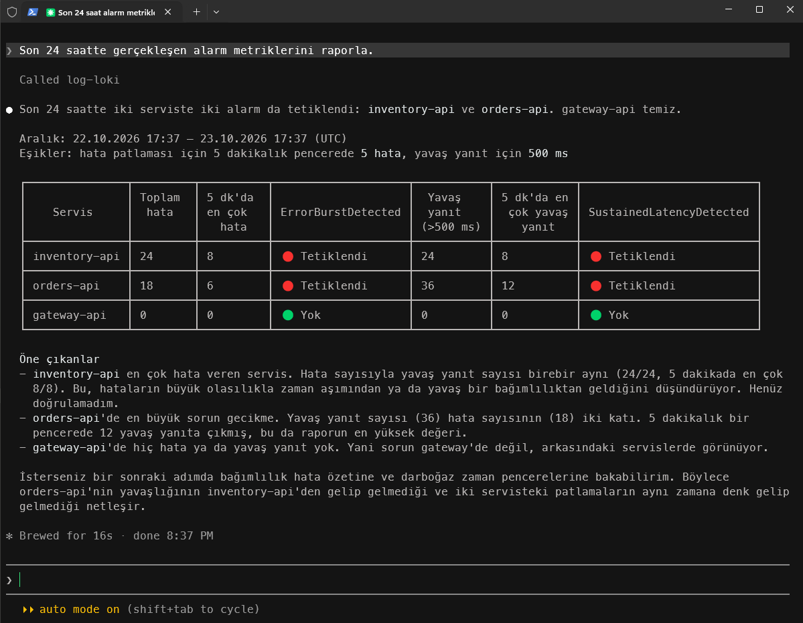
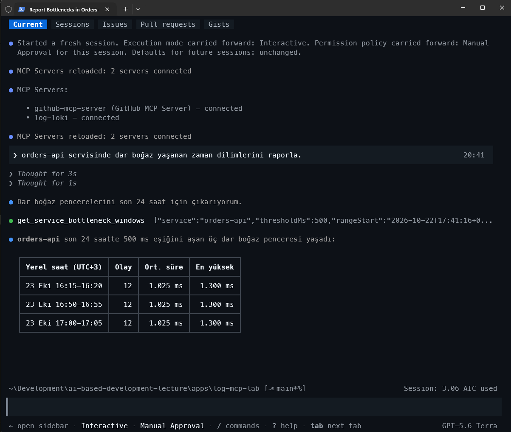
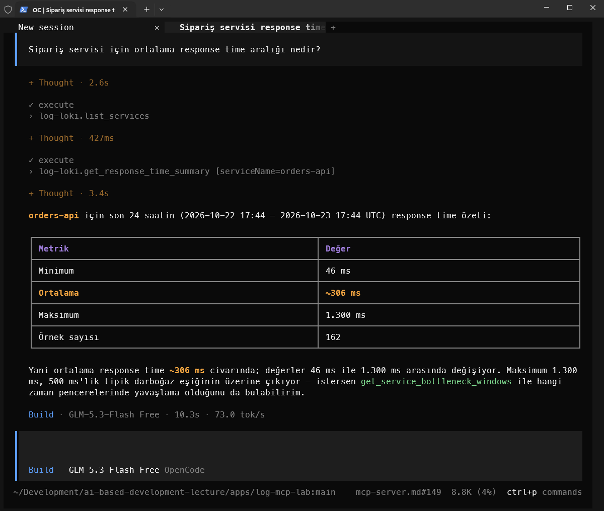

# Loki Log MCP Server

`LogMcpServer`, Faz 1 Loki kayıtlarını yapay zeka ajanlarının sorgulayabilmesi için geliştirilmiş .NET 10 stdio MCP sunucusudur. Sunucu yalnızca okunabilir analiz araçları sağlar.

## Ön koşullar

1. Faz 1 verisini üretin ve Loki yığınını başlatın:

   ```powershell
   Set-Location apps\log-mcp-lab
   python .\scripts\generate_logs.py
   docker compose -f .\docker-compose.loki.yml up -d
   ```

2. MCP sunucusunu derleyin:

   ```powershell
   dotnet build .\LogMcpServer\LogMcpServer.csproj
   ```

Loki adresi varsayılan olarak `http://localhost:3101`'dir. Farklı bir adres için MCP istemci ortamına `Loki__BaseUrl` ekleyin.

## MCP istemci yapılandırması

Depoda her istemci için hazır, **makineden bağımsız** yapılandırma dosyaları bulunur. Hiçbirinde mutlak yol yoktur; bu yüzden depoyu klonlayan herkes dosyaları değiştirmeden kullanabilir.

| İstemci | Dosya | Yol nasıl çözülür? |
|---|---|---|
| VS Code (Copilot Chat, agent mode) | `.vscode/mcp.json` | `${workspaceFolder}` değişkeni |
| Claude Code | `.mcp.json` | Göreli yol, `claude` komutunun çalıştırıldığı klasör |
| GitHub Copilot CLI | `.mcp.json` (Claude Code ile ortak) | Göreli yol, `copilot` komutunun çalıştırıldığı klasör |
| OpenCode | `opencode.json` | Göreli yol, `opencode` komutunun çalıştırıldığı klasör |

> Göreli yollar komutun çalıştığı klasöre göre çözülür. CLI araçlarını **`apps/log-mcp-lab` klasöründen** başlatın. VS Code'da bu klasörü ya da depo kökünü açabilirsiniz; depo kökündeki `.vscode/mcp.json` ve `opencode.json` aynı sunucuyu kök klasöre göre tanımlar.

İlk çalıştırmadan önce sunucuyu bir kez derleyin; `dotnet run` ilk açılışta derleme yaptığı için aksi halde istemci zaman aşımına düşebilir:

```powershell
dotnet build .\LogMcpServer\LogMcpServer.csproj
```

Loki farklı bir adresteyse ilgili dosyadaki `Loki__BaseUrl` değerini değiştirin.

### VS Code

`apps/log-mcp-lab` klasörünü (veya depo kökünü) açın. `.vscode/mcp.json` otomatik algılanır; dosyanın üzerindeki **Start** bağlantısıyla veya Komut Paleti'nden `MCP: List Servers` ile `log-loki` sunucusunu başlatın. Araçlar Copilot Chat'in **Agent** modunda görünür.

```json
{
  "servers": {
    "log-loki": {
      "type": "stdio",
      "command": "dotnet",
      "args": ["run", "--project", "${workspaceFolder}/LogMcpServer/LogMcpServer.csproj"],
      "env": { "Loki__BaseUrl": "http://localhost:3101" }
    }
  }
}
```

### Claude Code ve GitHub Copilot CLI

İki araç da proje kökündeki `.mcp.json` dosyasını ve `mcpServers` anahtarını okur; tek dosya ikisine de yeter.

```json
{
  "mcpServers": {
    "log-loki": {
      "type": "stdio",
      "command": "dotnet",
      "args": ["run", "--project", "LogMcpServer/LogMcpServer.csproj"],
      "env": { "Loki__BaseUrl": "http://localhost:3101" }
    }
  }
}
```

**Claude Code:**

```powershell
Set-Location apps\log-mcp-lab
claude
```

İlk açılışta proje kapsamlı `log-loki` sunucusunu onaylayın. Durumu oturum içinde `/mcp` komutuyla veya terminalde `claude mcp list` ile görebilirsiniz. Örnek çalışma zamanı çıktısı aşağıdaki gibidir.



**GitHub Copilot CLI:**

```powershell
Set-Location apps\log-mcp-lab
copilot
```

Copilot CLI, çalışma alanı MCP sunucularını yalnızca **güvenilen klasörlerde** yükler; ilk açılıştaki güven sorusunu onaylayın. Sunucuyu `/mcp` komutuyla kontrol edin. Notlar:

- Copilot CLI artık `.vscode/mcp.json` okumaz; `.mcp.json` kullanılır.
- `copilot -p "..."` (prompt modu) çalışma alanı MCP dosyasını varsayılan olarak yüklemez. Gerekirse `GITHUB_COPILOT_PROMPT_MODE_WORKSPACE_MCP=true` ortam değişkenini tanımlayın.

Örnek çalışma zamanı çıktısı aşağıdaki gibidir.



### OpenCode

```powershell
Set-Location apps\log-mcp-lab
opencode
```

`opencode.json` proje klasöründen okunur. Sunucunun durumunu `opencode mcp list` ile kontrol edebilirsiniz.

```json
{
  "$schema": "https://opencode.ai/config.json",
  "mcp": {
    "log-loki": {
      "type": "local",
      "command": ["dotnet", "run", "--project", "LogMcpServer/LogMcpServer.csproj"],
      "environment": { "Loki__BaseUrl": "http://localhost:3101" },
      "enabled": true,
      "timeout": 15000
    }
  }
}
```

OpenCode için örnek çalışma zamanı çıktısı da aşağıdaki gibidir.



## Araçlar

| Araç | Parametreler | Sonuç |
|---|---|---|
| `list_services` | İsteğe bağlı `startTime`, `endTime` | Zaman aralığında log üreten hizmet adları (`service_name`) |
| `get_service_bottleneck_windows` | `serviceName`, isteğe bağlı `thresholdMs`, `startTime`, `endTime` | Eşik üstü response-time olaylarının beş dakikalık pencereleri |
| `get_alarm_metrics` | İsteğe bağlı `serviceName`, `startTime`, `endTime` | Hata patlaması ve gecikme için hizmet bazlı toplamlar ile en yüksek beş dakikalık pencere |
| `get_response_time_summary` | `serviceName`, isteğe bağlı `startTime`, `endTime` | Minimum, ortalama ve maksimum response time |
| `get_error_burst_summary` | İsteğe bağlı `serviceName`, `startTime`, `endTime` | Hizmet ve hata türüne göre hata sayısı ile ilk/son görülme zamanı |
| `get_dependency_failure_summary` | İsteğe bağlı `serviceName`, `startTime`, `endTime` | Bağımlı hizmet ve HTTP durumuna göre dependency failure özeti |
| `search_logs` | İsteğe bağlı `serviceName`, `severity`, `eventName`, `limit`, `startTime`, `endTime` | En fazla 100 ham log kaydı |

Zamanlar RFC 3339 UTC biçiminde verilmelidir; `startTime` ve `endTime` birlikte sağlanır. İkisi de boşsa araçlar son 24 saati sorgular.

Araçlar herhangi bir hizmet için çalışır; sunucuda sabit kodlanmış hizmet adı veya takma ad yoktur. `serviceName`, Loki'deki `service_name` etiketinin birebir değeridir (Faz 1 verisinde `gateway-api`, `orders-api`, `inventory-api`). Kullanıcı hizmeti farklı bir adla anarsa (“ödeme servisi”, “sipariş API'si”) ajan önce `list_services` ile mevcut adları alır, eşleştirmeyi kendisi yapar ve emin değilse kullanıcıya sorar. Yeni bir hizmetin logları Loki'ye geldiği anda araçlar kod değişikliği olmadan onu da sorgulayabilir.

## Örnek ajan soruları

1. “Loki'de log üreten hizmetleri listele.”
2. “orders-api servisinde dar boğaz yaşanan zaman dilimlerini raporla.”
3. “Son 24 saatte gerçekleşen alarm metriklerini raporla.”
4. “Sipariş servisi için ortalama response time aralığı nedir?” (ajan `list_services` ile `orders-api` adını bulur)
5. “Son bir saatte en fazla hata üreten hizmet hangisi?”
6. “gateway-api için hata patlaması özetini çıkar.”
7. “Orders API'nin inventory bağımlılığındaki hata örüntüsünü göster.”
8. “Son 30 dakikadaki `WARN` kayıtlarını listele.”

## Sınırlar ve hata davranışı

- Hizmet adları, önem seviyeleri ve olay adları doğrulanır; kullanıcı girdisi ham LogQL olarak çalıştırılmaz.
- Her Loki isteği en fazla 2.000 kaynak kayıtla, `search_logs` ise en fazla 100 sonuçla sınırlıdır.
- Loki erişilemezse veya geçersiz zaman aralığı sağlanırsa araç çağrısı açıklayıcı hata ile başarısız olur.
- `get_alarm_metrics`, Alertmanager geçmişi değil; Faz 1 Loki kurallarındaki eşiklere karşılık gelen log tabanlı ölçümleri döndürür.
