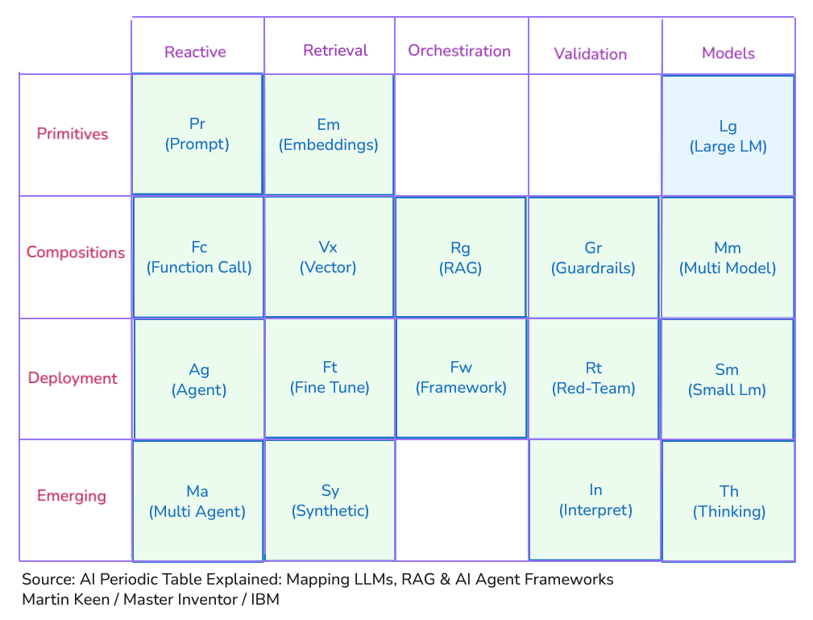
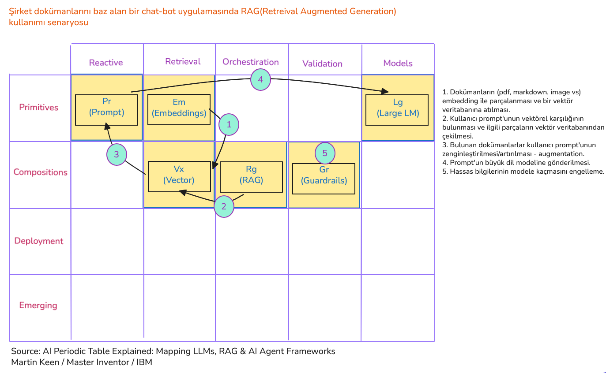
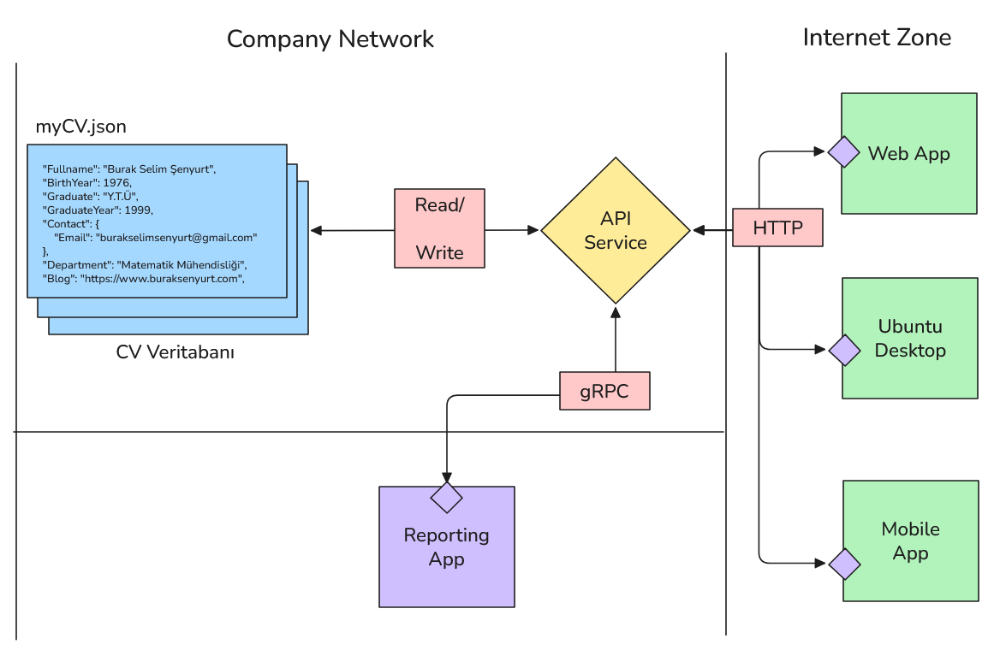

<a id="top"></a>

# Bölüm 01: Ders Hakkında, Yapay Zeka Terminolojisi ve İlk Uygulama

<!-- nav:top:start -->
[İçindekiler](README.md#top) · [Bölüm 02 →](chapter-02.md#top)
<!-- nav:top:end -->

## Önsöz

Yapay zeka araçları günümüzün en popüler konularından biri olsa da, bu araçların yazılım geliştirme süreçlerine entegrasyonu henüz tam olarak anlaşılmış değil. Bu dersin amacı, yapay zeka destekli yazılım geliştirme süreçlerini anlamak ve bu süreçlerde karşılaşılabilecek zorlukları ele almaktır. Ders boyunca, yapay zeka araçlarının yazılım geliştirme süreçlerine nasıl entegre edileceği, avantajları/dezavantajları ve bu araçların kullanımı sırasında karşılaşılabilecek zorluklar üzerinde durulacaktır. Ayrıca, yapay zeka destekli yazılım geliştirme süreçlerinde güvenlik, teknik borç ve proje mimarisi gibi önemli konulara da değinilecektir. Dönem boyunca aşağıdaki soruların cevaplarını arayacağız:

- Yapay zeka araçları hangi vakalarda yazılım geliştirme süreçlerine entegre edilebilir?
- Yapay zeka araçlarının yazılım geliştirme süreçlerine entegrasyonunun avantajları ve dezavantajları nelerdir?
- Bir yapay zeka aracının ürettiği çıktıda hangi konulara dikkat etmek gerekir? Riskler nelerdir? Risklerden nasıl kaçınılır?
- Yapay zeka destekli yazılım geliştirme süreçlerinde güvenlik, teknik borç ve proje mimarisi gibi konular nasıl ele alınmalıdır?
- İdeal veya ideale yakın, hata payı düşük çıktıları elde etmek için ne gibi metodolojiler izlenebilir? Hangi teknikler kullanılır?
- Spec veya test odaklı geliştirme gibi metodolojiler yapay zeka destekli yazılım geliştirme süreçlerinde nasıl uygulanabilir?
- Yapay zeka araçlarındaki sık değişimlere adapte olmak için ne gibi stratejiler izlenebilir?
- Kaynak tüketimi yüksek yapay zeka araçlarını kullanırken maliyetleri kontrol altında tutmak için ne gibi önlemler alınabilir? Optimizasyon teknikleri nelerdir?


## Yapay Zeka Alanındaki Anahtar Terimler

Yazılım geliştirme süreçlerinde yapay zeka araçlarından verimli şekilde yararlanmak için bazı temel terimlerin bilinmesi önemlidir. Bu terimler yapay zeka ile ilgili konularda başrolde yer alır. Tüm zamanların en üretken 200 mucidinden biri olarak görülen **IBM Baş Mucitlerinden *(Master Inventor)*** [Martin Keen](https://www.ibm.com/think/insights/behind-the-scenes-with-tech-trailblazers-meet-martin-keen), yapay zeka konusundaki terminolojiyi kimya derslerinden aşina olduğumuz periyodik cetvelle ilişkilendirmektedir.



Sütunlar beş ayrı grubu temsil etmektedir. Bunları kısaca aşağıdaki gibi özetleyebiliriz.

- **Reactive:** Değişen girdiyle çıktının da değiştiği etkileşime ait enstrümanları barındırır. Herkesin az çok aşina olduğu **prompt**'lar en temel istek gönderme biçimini tarif eder. Modelin bir başka fonksiyonu çağırabilmesi, birden fazla modelin birbirini çağırarak çalışması gibi kavramlar da bu grupta yer alır.
- **Retrieval:** Yapay zeka sistemlerinin bilgiyi nasıl aradığı, sakladığı ve hatırladığı ile ilgili kavramlar yer alır. Örneğin metinlerin sayısal temsilcileri *(embeddings)* ve bunların bir vektör uzayında temsil edilmesi ve benzerlik ölçümleri yapılarak erişilmesi gibi kavramları bu grupta düşünebiliriz.
- **Orchestration:** Tek bir birimin yapamayacağı işlerde birden fazla öğenin bir araya getirilerek işlendiği yöntemleri içerir. **RAG (Retrieval Augmented Generation)** yaklaşımı veya ihtiyaç duyulan tüm altyapıyı sunan **Framework**'ler bu grupta yer alır.
- **Validation:** Sistemin güvenliğini, doğruluğunu ve etik standartlara uygunluğunu sağlamak için kullanılan yöntemler bu grupta yer alır. Yapay zekanın hatalı veya zararlı çıktılar üretmesini engellemek için gerekli araçlar söz konusudur. Guardrail araçları ile zararlı çıktıları engellemek mümkündür. Ayrıca sistemin kırılganlığını test etmek için **Red Teaming** gibi yöntemler kullanılır.
- **Models:** Her şeyin etrafında döndüğü model ailesi bu grupta yer alır. Büyük dil modellerinin yanı sıra görüntü ve ses işleyebilen çoklu modeller ve akıl yürütme *(reasoning)* süreçleri ile gelişmiş düşünme *(thinking)* modellerini içerir.

Tablonun satırları da 4 kategoriye ayrılır. Bunları aşağıdaki gibi özetleyebiliriz.

- **Primitives:** Yapay zeka dünyasının en temel yapı taşlarını, yerinde bir benzetmeyle atomlarını temsil eder. Buradaki öğeler daha küçük parçalara bölünemezler ve aslında tablodaki diğer karmaşık yapılar tarafından kullanılır; onların temellerini oluştururlar. Örneğin **prompt**'lar yapay zeka araçlarına verilen girdilerin temel birimi olarak düşünülebilir. **Embedding**'ler ise metinlerin sayısal temsilleri olarak yapay zeka sistemlerinin bilgiyi işlemesi için temel bir yapı sağlar. Pek tabii büyük dil modelleri de burada yer alır.
- **Compositions:** Primitive'lerin bir araya getirilmesiyle oluşan daha karmaşık yapılar bu satırda yer alır. Genellikle yapım aşamasında bir modelin yanına yapılandırılmış çıktılar ve araç entegrasyonları eklenerek işlevsel bir süreç tesis edilir. Bu nedenle fonksiyon çağırma, vektör veritabanları, RAG ve Guardrails gibi unsurlar burada yer alır.
- **Emerging:** Günümüzde hızla evrilen ve yapay zeka ekosisteminin biraz da uç noktalarını temsil eden teknolojileri ifade eder. Halen gelişmekte olan bir alan gibi düşünülebilir. Örneğin yapay zekanın iş birliği yaptığı çoklu ajan sistemleri, modellerin iç mantığını anlamaya yarayan araçlar veya yanıt vermeden önce uzun süre muhakeme yapabilen düşünme modelleri burada yer alır.

Bu bileşimler yine Martin tarafından örnek senaryolarda pekiştirilmiştir. Örneğin bir şirketin kendi iç dokümanlarını baz alarak geliştirdiği bir chat-bot uygulamasında RAG yaklaşımının nasıl kullanıldığı ve bu süreçte hangi araçların devreye girdiği aşağıdaki görselde olduğu gibi özetlenebilir.



Müfredat boyunca yukarıda bahsettiğimiz birçok kavrama değinme fırsatı bulacağız.


## Tanışma ve `Hello World` Uygulamasının Geliştirilmesi

Bu ilk dersimizde **JSON** veri formatında tasarlanmış bir CV dosyasının analiz edilerek **HTML** formatında bir web sayfasına dönüştürülmesi üzerine çalışıldı. Anthropic'in **Claude Sonnet 4.5** modelini kullanarak bu dönüşümü gerçekleştirmek için çeşitli prompt'lar denedik.

İlk derste kullandığımız prompt'lar:

```text
Bu JSON içeriğini analiz et ve bir html sayfası hazırla.

Kullanıcı dostu bir arayüz sağla.
HTML 5 standartlarını kullan.
Custom CSS kullanma. Bunun yerine Bootstrap kütüphanesini kullan.
JSON içeriğini okumak için Javascript kullan.
```

Alınan CORS *(Cross-Origin Resource Sharing)* hatasına istinaden şu prompt ile devam ettik.

```text
Çalışma zamanında aşağıdaki hatayı alıyorum.

Cross-Origin Request Blocked: The Same Origin Policy disallows reading the remote resource at file:///C:/Users/burak/Development/ai-based-development-lecture/apps/lesson00/myCV.json. (Reason: CORS request not http)

Bir web sunucusu çalıştırmak gerekir mi?
```

ve bunun üzerine **Node.js**'in **http-server** paketini kullanarak basit bir web sunucusu kurmasını istedik.

```text
Sunucuyu komut satırından başlatmak yerine bir nodejs uygulaması ile başlatmak istiyorum.
```

Web sunucusunu başlatmak için aşağıdaki komut kullanılabilir.

```bash
npm run dev
```

Nihai amacımız, orta ölçekte bir CV bankası uygulaması geliştirmek ve bu süreçte yapay zeka araçlarını kullanmaktır. Başlangıç aşamasında bu uygulamanın yüksek seviyede nasıl görüneceğine dair bir diyagram çizdik.



**Ödev:** Amacımız bu diyagrama göre projemizi bir adım daha ileri götürmek. Nereden başlarsınız ve Agent'a nasıl bir prompt verirsiniz?

### Bu çalışmadan çıkarılması gereken dersler

- Hayata geçirmek istediğimiz proje fikri için hakim olduğumuz programlama dili ve framework'leri tercih etmeliyiz.
- AI agent'ları ile çalışırken açık ve net prompt'lar vermeliyiz.
- Üretilen kodların herhangi bir güvenlik açığı içermediğinden, teknik borç oluşturmadığından ve projenin genel mimarisine uygun olduğundan emin olmalıyız.
- Üretilen programda harici paket bağımlılıkları varsa, bu paketlerin güvenilir ve güncel olduğundan emin olmalıyız. Güvenlik açıkları içerebilecek eski paketlerden kaçınmalıyız.
- Komple bir proje yazdırmak yerine küçük parçalar halinde kod üretmenin daha verimli olabileceğini göz önüne alarak ilerlemeliyiz.

<!-- nav:bottom:start -->
---

| ← Önceki Bölüm | İçindekiler | Sonraki Bölüm → |
| :--- | :---: | ---: |
|  | [İçindekiler](README.md#top) | [Bölüm 02: CV Bank Projesi için Prototip Geliştirme](chapter-02.md#top) |
<!-- nav:bottom:end -->
