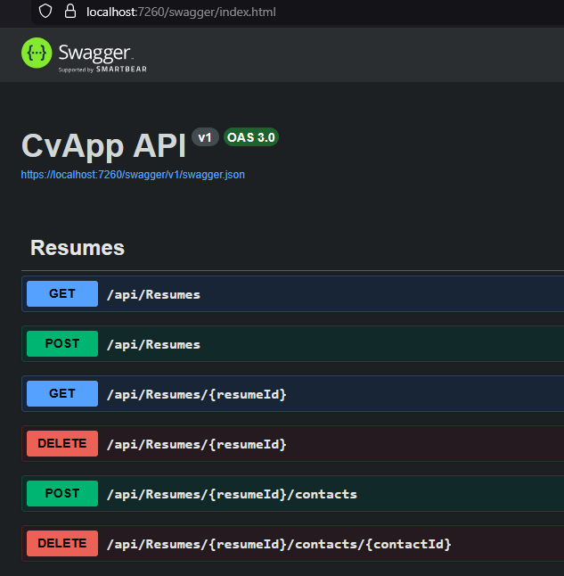

<a id="top"></a>

# Bölüm 02: CV Bank Projesi için Prototip Geliştirme

<!-- nav:top:start -->
[← Bölüm 01](chapter-01.md#top) · [İçindekiler](README.md#top) · [Bölüm 03 →](chapter-03.md#top)
<!-- nav:top:end -->

İkinci dersimizde en temel seviyede mimari özet ve domain bilgileri içeren temel dokümanlar hazırlayarak ilerledik. [Lesson01](./apps/lesson01/docs/) klasöründen bu dokümanlara erişebilirsiniz.

YZ modeli olarak Claude Sonnet 4.6'yı kullandık. Prompt oturumuna [00-architecture-overiview](./apps/lesson01/docs/00-architecture-overiview.md) ve [01-domain-design](./apps/lesson01/docs/01-domain-design.md) dokümanlarını ekledik. Ardından aşağıdaki prompt'u işlettik.

```text
Bu dokümanları analiz et ve sadece backend tarafı için gerekli Solution'ı oluştur.
```

Beklediğimiz gibi **.NET 10** tabanlı bir solution oluşturuldu. Klasör bazlı bir ayrım olmasa da projeler **Clean Architecture** yaklaşımında belirtildiği gibi **Domain**, **Application**, **Infrastructure** ve **Presentation** katmanlarına ayrıldı. Domain katmanında User, Contact gibi entity'ler ve Resume gibi aggregate'ler tanımlandı. **API** katmanında ise **REST API** standartlarına uygun ve Resume aggregate'ine yönelik **CRUD *(Create, Read, Update, Delete)*** operasyonlarını içeren bir **Controller** oluşturulduğu görüldü.

Ayrıca veritabanı tarafı için MongoDB tercih edildiği ve bağlantı ayarlarının `appsettings.json` dosyasına eklendiği görüldü. Domain tasarımında **ContactType** adında bir enum tanımlanarak iletişim türlerinin sınırlı bir küme ile ifade edildiği gözlemlendi.

Solution ilk seferde derlenmedi; zira eksik NuGet paketleri vardı. Ancak ajan sorunları kendisi düzelterek projeyi derlenebilir hale getirdi. Projeyi çalıştırdığımızda **Swagger** arayüzünde tanımlı endpoint'lerin beklendiği gibi göründüğü ve çalıştığı görüldü.



Ancak;

- Daha zengin ve kaliteli bir mimari tasarım dokümanı hazırlamanın daha iyi sonuçlar vereceği anlaşılıyor. Örneğin **API** standartlarının detaylı bir şekilde tanımlanması, API katmanında daha eksiksiz ve standartlara uygun bir **Controller** oluşturulmasını sağlayabilir. Listeleme endpoint'lerinin sayfalama desteği içermesi, veri oluşturma/güncelleme/silme endpoint'lerinin **HTTP** metodlarına uygun şekilde tasarlanması gibi detaylar mimari dokümanında ne kadar iyi tanımlanırsa, üretilen kodun kalitesi ve mimari uyumu o kadar artabilir.
- **Domain** tasarımının detaylı ve iyi tanımlanmış olması, üretilen kodun kalitesini ve mimari uyumunu artırabilir. Bu da ilgili domain hakkında yetkin bilgiye sahip olmayı ve **DDD *(Domain Driven Design)*** prensiplerini iyi bilmeyi gerektirmektedir. Domain tasarımında entity'lerin, aggregate'lerin ve value object'lerin doğru şekilde tanımlanması, kodun okunabilirliğini, bakımını ve genişletilebilirliğini artırır.

<!-- nav:bottom:start -->
---

| ← Önceki Bölüm | İçindekiler | Sonraki Bölüm → |
| :--- | :---: | ---: |
| [Bölüm 01: Ders Hakkında, Yapay Zeka Terminolojisi ve İlk Uygulama](chapter-01.md#top) | [İçindekiler](README.md#top) | [Bölüm 03: Exception Handling, Debugging ve Docker Kullanımı](chapter-03.md#top) |
<!-- nav:bottom:end -->
