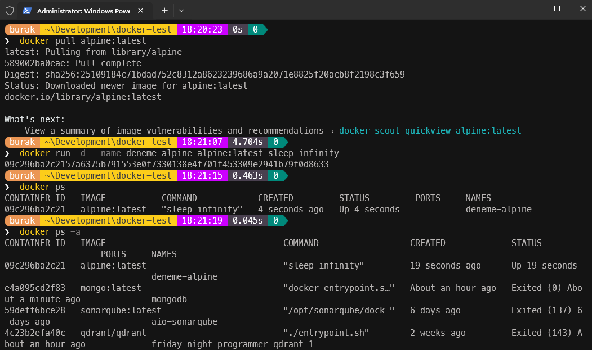
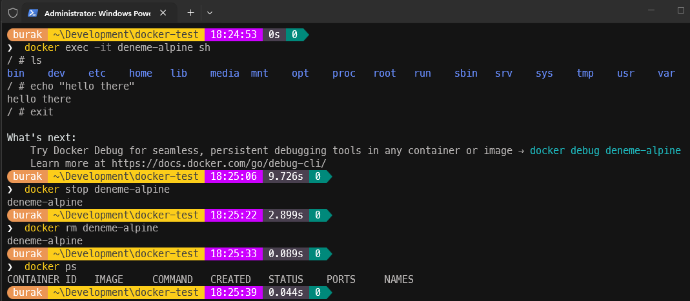
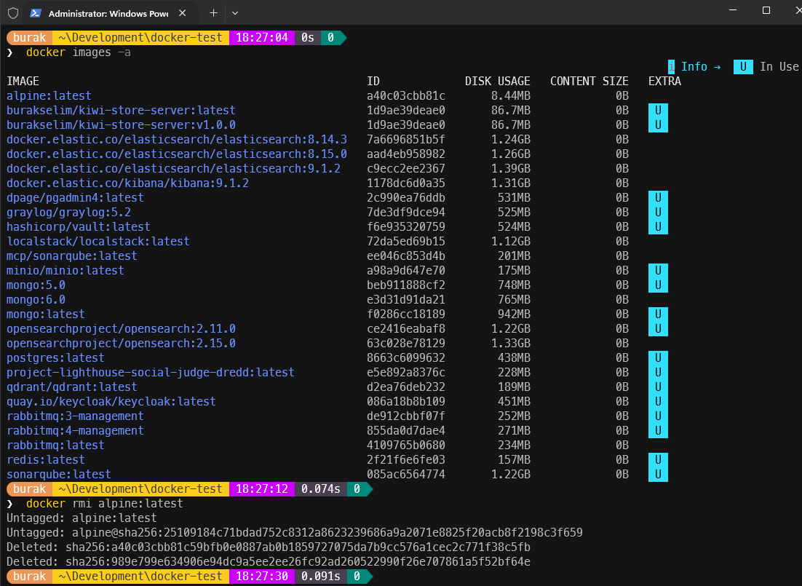

<a id="top"></a>

# Bölüm 03: Exception Handling, Debugging ve Docker Kullanımı

<!-- nav:top:start -->
[← Bölüm 02](chapter-02.md#top) · [İçindekiler](README.md#top) · [Bölüm 04 →](chapter-04.md#top)
<!-- nav:top:end -->

Bu derste **Swagger** üzerinden yaptığımız API testleri sırasında aldığımız çalışma zamanı hatalarına istinaden **.NET** gibi yönetimli ortamlarda *(Managed Environment)* istisna/hata yönetiminin nasıl ele alındığına değindik. Özellikle **Exception** mesajlarındaki **Call Stack log'larının** nasıl okunması gerektiğine baktık ki gözlerimizi acıtan **Call Stack** içeriği de aşağıdaki gibiydi; ancak satır satır yorumladık.

```text
System.TimeoutException: A timeout occurred after 30006ms selecting a server using CompositeServerSelector{ Selectors = ReadPreferenceServerSelector{ ReadPreference = { Mode : Primary } }, LatencyLimitingServerSelector{ AllowedLatencyRange = 00:00:00.0150000 }, OperationsCountServerSelector }. Client view of cluster state is { ClusterId : "1", Type : "Unknown", State : "Disconnected", Servers : [{ ServerId: "{ ClusterId : 1, EndPoint : "Unspecified/localhost:27017" }", EndPoint: "Unspecified/localhost:27017", ReasonChanged: "Heartbeat", State: "Disconnected", ServerVersion: , TopologyVersion: , Type: "Unknown", HeartbeatException: "MongoDB.Driver.MongoConnectionException: An exception occurred while opening a connection to the server.
 ---> System.Net.Sockets.SocketException (10061): No connection could be made because the target machine actively refused it. [::1]:27017
   at System.Net.Sockets.Socket.DoConnect(EndPoint endPointSnapshot, SocketAddress socketAddress)
   at System.Net.Sockets.Socket.Connect(EndPoint remoteEP)
   at MongoDB.Driver.Core.Connections.TcpStreamFactory.Connect(Socket socket, EndPoint endPoint, CancellationToken cancellationToken)
   at MongoDB.Driver.Core.Connections.TcpStreamFactory.CreateStream(EndPoint endPoint, CancellationToken cancellationToken)
   at MongoDB.Driver.Core.Connections.BinaryConnection.OpenHelper(OperationContext operationContext)
   --- End of inner exception stack trace ---
   at MongoDB.Driver.Core.Connections.BinaryConnection.OpenHelper(OperationContext operationContext)
   at MongoDB.Driver.Core.Connections.BinaryConnection.Open(OperationContext operationContext)
   at MongoDB.Driver.Core.Servers.ServerMonitor.InitializeConnection(OperationContext operationContext)
   at MongoDB.Driver.Core.Servers.ServerMonitor.Heartbeat(CancellationToken cancellationToken)", LastHeartbeatTimestamp: "2026-02-27T12:20:55.5434132Z", LastUpdateTimestamp: "2026-02-27T12:20:55.5434133Z" }] }.
   at MongoDB.Driver.Core.Clusters.Cluster.SelectServerAsync(OperationContext operationContext, IServerSelector selector)
   at MongoDB.Driver.Core.Clusters.IClusterExtensions.SelectServerAndPinIfNeededAsync(IClusterInternal cluster, OperationContext operationContext, ICoreSessionHandle session, IServerSelector selector, IReadOnlyCollection`1 deprioritizedServers)
   at MongoDB.Driver.Core.Bindings.ReadPreferenceBinding.GetReadChannelSourceAsync(OperationContext operationContext, IReadOnlyCollection`1 deprioritizedServers)
   at MongoDB.Driver.Core.Operations.RetryableReadContext.AcquireOrReplaceChannelAsync(OperationContext operationContext, IReadOnlyCollection`1 deprioritizedServers)
   at MongoDB.Driver.Core.Operations.RetryableReadContext.CreateAsync(OperationContext operationContext, IReadBinding binding, Boolean retryRequested)
   at MongoDB.Driver.Core.Operations.FindOperation`1.ExecuteAsync(OperationContext operationContext, IReadBinding binding)
   at MongoDB.Driver.OperationExecutor.ExecuteReadOperationAsync[TResult](OperationContext operationContext, IClientSessionHandle session, IReadOperation`1 operation, ReadPreference readPreference, Boolean allowChannelPinning)
   at MongoDB.Driver.MongoCollectionImpl`1.ExecuteReadOperationAsync[TResult](IClientSessionHandle session, IReadOperation`1 operation, ReadPreference explicitReadPreference, Nullable`1 timeout, CancellationToken cancellationToken)
   at MongoDB.Driver.MongoCollectionImpl`1.FindAsync[TProjection](FilterDefinition`1 filter, FindOptions`2 options, CancellationToken cancellationToken)
   at MongoDB.Driver.IAsyncCursorSourceExtensions.ToListAsync[TDocument](IAsyncCursorSource`1 source, CancellationToken cancellationToken)
   at CvApp.Infrastructure.Persistence.Repositories.ResumeRepository.GetAllAsync(CancellationToken cancellationToken) in C:\Users\burak\Development\ai-based-development-lecture\apps\lesson01\src\CvApp.Infrastructure\Persistence\Repositories\ResumeRepository.cs:line 38
   at CvApp.Application.Services.ResumeService.GetAllAsync(CancellationToken cancellationToken) in C:\Users\burak\Development\ai-based-development-lecture\apps\lesson01\src\CvApp.Application\Services\ResumeService.cs:line 26
   at CvApp.Api.Controllers.ResumesController.GetAll(CancellationToken cancellationToken) in C:\Users\burak\Development\ai-based-development-lecture\apps\lesson01\src\CvApp.Api\Controllers\ResumesController.cs:line 23
   at Microsoft.AspNetCore.Mvc.Infrastructure.ActionMethodExecutor.TaskOfIActionResultExecutor.Execute(ActionContext actionContext, IActionResultTypeMapper mapper, ObjectMethodExecutor executor, Object controller, Object[] arguments)
   at Microsoft.AspNetCore.Mvc.Infrastructure.ControllerActionInvoker.<InvokeActionMethodAsync>g__Awaited|12_0(ControllerActionInvoker invoker, ValueTask`1 actionResultValueTask)
   at Microsoft.AspNetCore.Mvc.Infrastructure.ControllerActionInvoker.<InvokeNextActionFilterAsync>g__Awaited|10_0(ControllerActionInvoker invoker, Task lastTask, State next, Scope scope, Object state, Boolean isCompleted)
   at Microsoft.AspNetCore.Mvc.Infrastructure.ControllerActionInvoker.Rethrow(ActionExecutedContextSealed context)
   at Microsoft.AspNetCore.Mvc.Infrastructure.ControllerActionInvoker.Next(State& next, Scope& scope, Object& state, Boolean& isCompleted)
   at Microsoft.AspNetCore.Mvc.Infrastructure.ControllerActionInvoker.<InvokeInnerFilterAsync>g__Awaited|13_0(ControllerActionInvoker invoker, Task lastTask, State next, Scope scope, Object state, Boolean isCompleted)
   at Microsoft.AspNetCore.Mvc.Infrastructure.ResourceInvoker.<InvokeFilterPipelineAsync>g__Awaited|20_0(ResourceInvoker invoker, Task lastTask, State next, Scope scope, Object state, Boolean isCompleted)
   at Microsoft.AspNetCore.Mvc.Infrastructure.ResourceInvoker.<InvokeAsync>g__Awaited|17_0(ResourceInvoker invoker, Task task, IDisposable scope)
   at Microsoft.AspNetCore.Mvc.Infrastructure.ResourceInvoker.<InvokeAsync>g__Awaited|17_0(ResourceInvoker invoker, Task task, IDisposable scope)
   at Microsoft.AspNetCore.Authorization.AuthorizationMiddleware.Invoke(HttpContext context)
   at Swashbuckle.AspNetCore.SwaggerUI.SwaggerUIMiddleware.Invoke(HttpContext httpContext)
   at Swashbuckle.AspNetCore.Swagger.SwaggerMiddleware.Invoke(HttpContext httpContext, ISwaggerProvider swaggerProvider)
   at Microsoft.AspNetCore.Authentication.AuthenticationMiddleware.Invoke(HttpContext context)
   at Microsoft.AspNetCore.Diagnostics.DeveloperExceptionPageMiddlewareImpl.Invoke(HttpContext context)
```

> Exception yönetimi her ne kadar işi kolaylaştıran bir yol olsa da runtime maliyetlerini de düşünerek **try...catch...finally** bloğuna ihtiyaç duymadan da bazı hataların yönetilebileceğini bilmemiz gerekir. Örneğin bir dosya üzerinde işlem yapan bir metot yazdığımızı düşünelim. Dosya üzerinde işlem yaparken dosyanın var olup olmadığını kontrol edebiliriz. Eğer dosya yoksa bu durumu bir istisna fırlatmak yerine, metot içerisinde yönetebiliriz. Bu sayede gereksiz yere **try...catch** bloğu kullanmayız, kodun okunurluğunu artırır, çalışma zamanını optimize ederiz. Ancak bazı hallerde istisna yönetimi kaçınılmaz olabilir. Örneğin, bir veritabanı bağlantısı kurarken, bağlantının başarısız olması gibi durumlarda istisna yönetimi kullanmak gerekebilir. Bu tür durumlarda, istisna yönetimi kullanarak hataları daha etkili bir şekilde ele alabilir ve uygulamanın çökmesini önleyebiliriz.

Ayrıca bir **.NET** uygulamasında nasıl debug yapılır, tarayıcılarda **Developer Tools** kullanılarak ağ trafiği ile request ve response bilgilerinin nasıl izlendiği konularına değindik. Bunun yanında [HTTP statü kodlarının](https://developer.mozilla.org/en-US/docs/Web/HTTP/Reference/Status) ne anlama geldiğine baktık.

Projede veritabanı olarak **MongoDB** kullanmaya karar vermiştik. Sisteme MongoDB ortamını kurmak yerine yerel *(local)* ortamda bir **[Docker](https://github.com/docker)** image'ı kullandık. Daha sonra çalıştığımız çözüme yeni servisler ekleyebileceğimiz için MongoDB servisini bir [docker-compose](./docker-compose.yml) dosyası içine aldık. Docker Compose dosyasında tanımlı olan servisleri ayağa kaldırmak oldukça basit. Bunun için terminalden aşağıdaki komutu çalıştırmak yeterli.

```bash
docker-compose up -d
```

**Windows** ve **macOS** gibi ortamlarda **[Docker Desktop](https://docs.docker.com/get-started/get-docker/)** uygulaması ile Docker imajları ve container'lar görsel bir arayüz üzerinden de yönetilebilir. **Linux** platformunda ise daha çok terminal üzerinden yönetim yapılır. Bazı temel ve ihtiyaç duyabileceğimiz komutların kullanımına ait basit örnekleri aşağıda bulabilirsiniz. Diğer yandan [Docker resmî sitesinde](https://docs.docker.com/get-started/docker_cheatsheet.pdf) faydalı bir **CLI Cheat Sheet** bulunmaktadır.

```bash
# Bir container başlatmak için
docker pull <image_name> # Eğer image localde yoksa önce çekilir
docker run --name <container_name> <image_name>

# Çalışan container'ları listele
docker ps

# Çalışan container'ları detaylarıyla listele
docker ps -a

# Belirli bir container'ın loglarını görüntüle
docker logs <container_id>

# Belirli bir container'ın içinde bash/sh terminali başlatmak için
docker exec -it <container_id> bash/sh

# Bir container'ı durdurmak için
docker stop <container_id>

# Bir container'ı başlatmak için
docker start <container_id>

# Bir container'ı silmek için
docker rm <container_id>

# Sistemdeki imajları listelemek için
docker images

# Sistemdeki imajları detaylarıyla listelemek için
docker images -a

# Kullanılmayan imajları silmek için
docker image prune

# Bir imajı silmek için
docker rmi <image_id>

# Docker compose ile tüm servisleri durdurmak için
docker-compose down

# Docker compose ile tüm servisleri yeniden başlatmak için
docker-compose restart
```

İşte birkaç denemeye ait ekran görüntüleri:







Bu derste kullandığımız prompt'lar:

```text
Prompt 1: Analyze this solution and then apply exception handling on controller level.

Prompt 2: Create a docker-compose file on root folder and add mongodb service.

Prompt 3: This docker-compose should be run on different network because we have different docker environments.
```

MongoDB erişimi sırasında aldığımız Authentication hatası nedeniyle şu prompt'u kullandık:

```text
Case: Runtime exception
When: curl -X 'GET' \
 'http://localhost:5020/api/Resumes' \
  -H 'accept: text/plain'
Exception Details:
fail: CvApp.Api.Filters.ApiExceptionFilterAttribute[0]
      Islenmeyen hata olustu: Command find failed: Command find requires authentication.
      MongoDB.Driver.MongoCommandException: Command find failed: Command find requires authentication.
```

## Dikkat Edilmesi Gereken Noktalar

Bknz: [Aman Dikkat](README.md#aman-dikkat)

<!-- nav:bottom:start -->
---

| ← Önceki Bölüm | İçindekiler | Sonraki Bölüm → |
| :--- | :---: | ---: |
| [Bölüm 02: CV Bank Projesi için Prototip Geliştirme](chapter-02.md#top) | [İçindekiler](README.md#top) | [Bölüm 04: Hata Yönetimi, Loglama ve İzleme](chapter-04.md#top) |
<!-- nav:bottom:end -->
