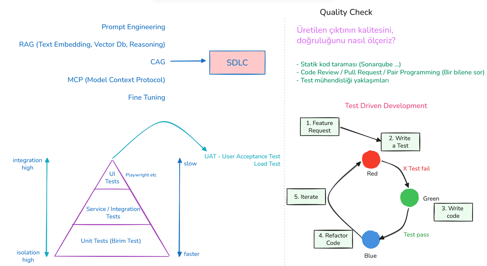

<a id="top"></a>

# Bölüm 06: Yazılım Çözümlerinde Testin Önemi

<!-- nav:top:start -->
[← Bölüm 05](chapter-05.md#top) · [İçindekiler](README.md#top) · [Bölüm 07 →](chapter-07.md#top)
<!-- nav:top:end -->



Yazılım geliştirme süreçlerinde testin önemli bir yeri vardır. Yazılan kodun beklentiler doğrultusunda çalıştığından emin olmak, hataları erken aşamada tespit etmek ve düzeltmek, kodun bakımını kolaylaştırmak gibi birçok avantaj sunar. Kodun kalitesinin artırılması açısından da biçilmiş kaftandır. Özellikle yapay zeka araçlarını veya metodolojilerini kullanarak kod üretirken, çıktıların beklediğimiz şekilde olduğundan emin olmak için de testlere başvurabiliriz. Günümüz yapay zeka asistanları koda bakarak eksik testleri yazabilmekte, var olan testleri analiz ederek kodun hangi bölümlerinin yeterince test edilmediğini tespit edebilmektedir. Ancak bu şekilde ilerliyor olsak da mutlaka yazılan testlerin anlamlı olup olmadığını gözden geçirmeliyiz.

Pek tabii kodun belli standartlar üzerinde olmasını sağlamak, sorunlarını azaltmak için test metodolojileri tek başına bir ölçüt değildir. **Sonarqube** gibi araçlar ile teknik borcu ölçmek, **Code Review/Pull Request** süreçlerini işletmek veya **pair programming** gibi pratiklerle ilerlemek de kod kalitesini artırmak için başvurulabilecek diğer yöntemlerdir.

Bu dersimizde diyagramda görülen bazı temel kavramlara değinmeye çalıştık. Bu anlamda klasik test piramidinin başlıca katmanlarını konuştuk. [Şu klasörde yer alan örnek projede](./apps/lesson04) birim test *(Unit Test)* ve entegrasyon testlerini *(Integration Test)* basit birkaç örnekle deneyimledik. Referans olarak uçtan uca bir deneyim için **Hexagonal Architecture** yaklaşımını benimseyen şu örneği de inceleyebilirsiniz: [Hexagonal Architecture Example](https://github.com/buraksenyurt/HexagonalArchitecture_101)

Ayrıca **Test Driven Development *(TDD)*** ya da *Red-Green-Blue* yaklaşımının temel prensiplerine baktık.

**.NET** tabanlı çözümümüzde solution oluşturmak ve proje eklemek için kullanabileceğimiz komutlar:

```bash
dotnet new sln -n DeppoApp
dotnet new classlib -n DeppoApp.Domain
dotnet new classlib -n DeppoApp.Application
dotnet sln add DeppoApp.Domain/DeppoApp.Domain.csproj
dotnet sln add DeppoApp.Application/DeppoApp.Application.csproj

# test projelerini oluşturup eklemek için
dotnet new xunit -n DeppoApp.Domain.Tests
dotnet new xunit -n DeppoApp.Application.Tests
dotnet sln add DeppoApp.Domain.Tests/DeppoApp.Domain.Tests.csproj
dotnet sln add DeppoApp.Application.Tests/DeppoApp.Application.Tests.csproj

# Solution içerisindeki tüm testleri koşmak için
dotnet test
```

Eksik birim testlerin tamamlanması ve entegrasyon testleri için kullandığımız prompt'lar:

**VS Code Copilot Tarafı (Model Claude Sonnet 4.6):**

```text
`Product` sınıfı için olası tüm birim testleri `ProductTests` bileşenine ekle.

`DecreaseStock` metodundaki son değişikliğe göre testleri düzelt. Gerekli görüyorsan `Product` sınıfına yeni iş kuralları ekle.
```

**Visual Studio Copilot Tarafı(Model Claude Sonnet 4.6):**

```text
Write an integration tests for `CreateProduct(Guid, string, decimal, int)` method into new xUnit test project. Use `Moq` framework for mocking real database.
```

> todo@buraksenyurt: UI testlerinde kullanılan araçlara bir örnek yapalım. Sisteme ürün ekleme senaryosunda **Playwright** ile bir arayüz testi eklenebilir.

Araştırılabilecek diğer kavramlar:

- Behavior Driven Development (BDD)
- User Acceptance Testing (UAT)
- Test Containers

<!-- nav:bottom:start -->
---

| ← Önceki Bölüm | İçindekiler | Sonraki Bölüm → |
| :--- | :---: | ---: |
| [Bölüm 05: Bağımlılıkları Yönetmek ve Kod Kalitesini Ölçmek](chapter-05.md#top) | [İçindekiler](README.md#top) | [Bölüm 07: Yazılım Mimarileri ve Temel Seviyede Bir Örnek](chapter-07.md#top) |
<!-- nav:bottom:end -->
