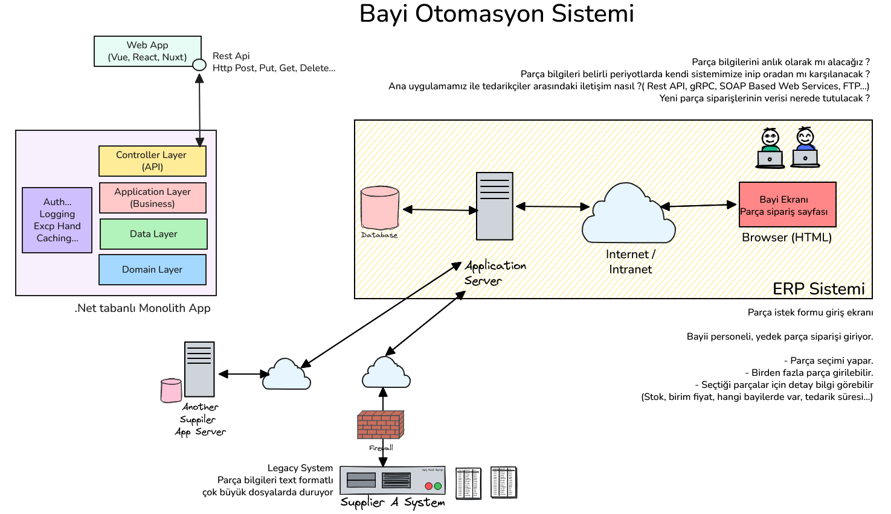

# Bölüm 07: Yazılım Mimarileri ve Temel Seviyede Bir Örnek

<!-- nav:top:start -->
[← Bölüm 06](chapter-06.md#top) · [İçindekiler](README.md#top) · [Bölüm 08 →](chapter-08.md#top)
<!-- nav:top:end -->

Bu dersimizde yazılım mimarileri konusunda genel ve yüzeysel bilgiler vermeye çalıştık. Konuya bir bayi otomasyon sisteminde yedek parça sipariş formu açılmasına ait ve aşağıdaki high-level diyagramda görülen örnek senaryo ile başladık.

Bu senaryoda bir bayi, yedek parça siparişi vermek istediğinde, sistemdeki stok durumunu kontrol eder. Eğer stokta yeterli miktarda ürün varsa, sipariş doğrudan işlenir. Ancak stokta yeterli ürün yoksa, sistem tedarikçi firmaya otomatik olarak bir sipariş oluşturur ve bayiyi bilgilendirir. Bu süreçte stok yönetimi, sipariş yönetimi ve tedarikçi entegrasyonu gibi farklı bileşenler devreye girebilir.

Kurumsal çaptaki uygulamalar bilinen belli başlı yazılım mimarileri çerçevesinde tasarlanır. **Layered Architecture**, **Microservices Architecture**, **Event-Driven Architecture**, **Serverless Architecture** gibi farklı mimari yaklaşımlar vardır. Her mimari yaklaşımın avantajları ve dezavantajları bulunur. Örneğin, Layered Architecture basit ve anlaşılır bir yapıya sahipken, Microservices Architecture daha esnek ve ölçeklenebilir çözümler sunabilir; ancak yönetimi ve kurulumu farklı yetkinlikler gerektirebilir. Bu nedenle, projenin ihtiyaçlarına, ekibin yetkinliklerine ve diğer faktörlere bağlı olarak en uygun mimari yaklaşımı seçmek önemlidir. Karar verme noktasında **Richards & Ford'un, Fundamentals of Software Architecture** kitabı referans olarak kullanılabilir. Mimarileri dağıtık ve monolitik olmak üzere iki ana kategoriye ayıran kitaba göre, farklı özellikler nezdinde bu mimarilerin avantajları ve dezavantajları aşağıdaki tablo ile özetlenebilir.

| **Özellik** | **Layered** | **Pipeline** | **Mikro Kernel** | **Service Based** | **Event Driven** | **Space Based** | **Service Oriented** | **Microservices** |
| --------- | --------- | ---------- | -------------- | --------------- | -------------- | ------------- | ------------------ | --------------- |
| **Partition Type** | Technical | Technical | Domain + Technical | Domain | Technical | Domain + Technical | Technical | Domain |
| **Number of Quanta** | 1 | 1 | 1 | 1..n | 1..n | 1..n | 1 | 1..n |
| **Deployability** | ★ | ★★ | | ★★★★ | ★★★ | ★★★ | ★ | ★★★★ |
| **Elasticity** | ★ | ★ | | ★★ | ★★★ | ★★★★ | ★★ | ★★★★★ |
| **Evolutianry** | ★ | ★★★ | | ★★★ | ★★★★★ | ★★★ | ★ | ★★★★★ |
| **Fault Tolerance** | ★ | ★ | | ★★★★ | ★★★★★ | ★★★ | ★★★ | ★★★★ |
| **Modularity** | ★ | ★★★ | | ★★★★ | ★★★★ | ★★★ | ★★★ | ★★★★★ |
| **Overall Cost** | ★★★★★ | ★★★★★ | ★★★★★ | ★★★★ | ★★★ | ★★ | ★ | ★ |
| **Performance** | ★★ | ★★ | ★★★ | ★★★ | ★★★★★ | ★★★★★ | ★★ | ★★ |
| **Reliability** | ★★★ | ★★★ | ★★★ | ★★★★ | ★★★ | ★★★★ | ★★ | ★★★★ |
| **Scalability** | ★ | ★ | ★ | ★★★ | ★★★★★ | ★★★★★ | ★★★★ | ★★★★★ |
| **Simplicity** | ★★★★★ | ★★★★★ | ★★★★ | ★★★ | ★ | ★ | ★ | ★ |
| **Testability** | ★★ | ★★★ | ★★★ | ★★★★ | ★★ | ★ | ★ | ★★★★ |

Derste işlenen diğer konular:

- **GitHub** sayfasında **Copilot Agent** kullanılarak lesson05 altında 3-tier mimarisine uygun örnek bir proje açılması istendi. Bu çalışmada Copilot'ın ayrı bir **branch** açması, bu branch üzerinden **code review** ve **pull request** işletilmesi gibi süreçler ele alındı. Bu senaryoda kullanılan prompt ise şu şekilde: *Create a new folder which name is lesson05 and than create a simple 3-tier based .net solution structure on this folder.*
- **Copilot CLI** aracından aynı solution için verilen plan dahilinde **[Architecture Decision Record (ADR)](https://martinfowler.com/bliki/ArchitectureDecisionRecord.html)** dokümanlarının oluşturulması istendi. **ADR**'ların ne olduğu, nasıl yazılması gerektiği ve neden önemli olduklarından bahsedildi. Pek tabii ajan tarafından oluşturulan dokümanların mutlaka gözden geçirilmesi, gerektiğinde müdahale edilmesi ve kararların mimari prensiplere uygun şekilde alınması gerektiğini bir kez daha vurgulayalım. Komut satırı aracı üzerinden kullanılan prompt ise şöyle:  */plan Analyse .net solution on lesson05. Create required `Architecture Decision Records` documents according the applied structure.*

> ADR dokümanları ile ilgili şunları söyleyebiliriz. Geri dönülmesi zor olan kararlar ADR'a girer. Örneğin PostgreSQL'den başka bir veritabanına geçmek kolay değil ve ciddi bir efor gerektiriyorsa bu bir risk teşkil eder ve bu nedenle bu karar ADR'a girmelidir. Ancak bir logging framework'ünden başka bir logging framework'üne geçmek çok kolaysa bu karar ADR'a girmeyebilir. ADR'ların amacı, mimari kararların neden alındığını, hangi alternatiflerin değerlendirildiğini ve bu kararların ne gibi sonuçlara yol açabileceğini belgelemektir. Bu sayede, gelecekte benzer kararlar alınırken geçmişteki deneyimlerden yararlanılabilir ve aynı hataların tekrarlanması önlenebilir.

<!-- nav:bottom:start -->
---

| ← Önceki Bölüm | İçindekiler | Sonraki Bölüm → |
| :--- | :---: | ---: |
| [Bölüm 06: Yazılım Çözümlerinde Testin Önemi](chapter-06.md#top) | [İçindekiler](README.md#top) | [Bölüm 08: Dağıtık Sistemler Hakkında Temel Bilgiler ve Basit Bir Senaryo Üzerinden İnceleme](chapter-08.md#top) |
<!-- nav:bottom:end -->
