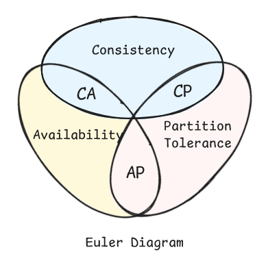

<a id="top"></a>

# Bölüm 08: Dağıtık Sistemler Hakkında Temel Bilgiler ve Basit Bir Senaryo Üzerinden İnceleme

<!-- nav:top:start -->
[← Bölüm 07](chapter-07.md#top) · [İçindekiler](README.md#top) · [Bölüm 09 →](chapter-09.md#top)
<!-- nav:top:end -->

Bir önceki derste ele aldığımız bayi otomasyon senaryosuna tekrar dönersek; bir bayi yedek parça siparişi verir, sistem stok durumunu kontrol eder, yeterli stok yoksa tedarikçiye otomatik sipariş kaydı açılır. [Bölüm 07](chapter-07.md#top)'deki mimari karşılaştırma tablosu açısından bakarsak bu senaryoyu **Layered** veya **Event-Driven** bir yaklaşım içerisinde ele almamız mümkündür. Ancak mimari karar tablosunu dikkatlice incelediğimizde ilginç bir gerçek fark edilir; **Elasticity**, **Fault Tolerance** ve **Evolutionary** gibi kriterlerde en yüksek puanı alan mimariler *(Event-Driven, Space-Based, Microservices)*, aynı zamanda **Overall Cost** ve **Simplicity** kriterlerinde en düşük puanı alan mimarilerdir. Bu son derece normaldir zira bu mimarilerin tamamı tek bir uygulama süreci *(process)* sınırının dışına çıkarak birden fazla bağımsız düğümün *(node)* ağ üzerinden iş birliği yapmasını gerektirir. İşte bu noktada **dağıtık sistemler** *(distributed systems)* disiplini devreye girer.

Bir sistemi dağıtık hale getirmek kodu birden fazla process'e bölmekten ibaret değildir. Aynı process içinde bir metot çağırmakla, ağ üzerinden başka bir servise istek göndermek arasında köklü farklar vardır. Yerel bir çağrı neredeyse anında sonuçlanır, her zaman bir yanıt döner ve bellek doğrudan paylaşılır. Ağ üzerinden yapılan bir çağrıda ise gecikme *(latency)* kaçınılmazdır. İsteğin karşı tarafa hiç ulaşmaması ya da ulaştığı halde yanıtın hiç dönmemesi gibi ihtimaller vardır ve iki taraf arasında paylaşılan bir bellek bloğu da fiziksel olarak yoktur.

**L. Peter Deutsch**'un tanımladığı ve daha sonra Sun Microsystems'daki meslektaşlarınca genişletilen **[Dağıtık Sistemlerin Yanılgıları](https://en.wikipedia.org/wiki/Fallacies_of_distributed_computing)** *(Fallacies of Distributed Computing)*, kod geliştiricilerin bu farkı unutarak düştüğü sekiz yaygın varsayımı listeler. Örneğin `ağ güvenilirdir`, `gecikme sıfırdır`, `bant genişliği sınırsızdır` gibi. Yapay zeka araçlarının kod üretme hızı arttıkça bu yanılgılara düşmek de oldukça kolaylaşıyor. Nitekim bir ajana **"şu iki servisi birbirine bağla"** demek birkaç satır kodla mümkün olurken, ağ hatalarına karşı dayanıklılığı otomatik olarak sağlaması beraberinde gelmez.



Dağıtık sistemlerde sıkça karşılaşılan bir diğer kavram da **Eric Brewer'ın** ortaya attığı **[CAP Teoremi](https://en.wikipedia.org/wiki/CAP_theorem)**'dir. *(Consistency, Availability, Partition Tolerance)* olarak da bilinen konuları ele alır. Teoreme göre bir dağıtık sistem, ağ bölünmesi *(network partition)* yaşandığında aynı anda hem tutarlı hem de her zaman erişilebilir olamaz. İkisinden birinden ödün vermek zorunda kalır *(partition tolerance zaten dağıtık bir sistemde vazgeçilemez kabul edilir)*. Bu tercih projenin ihtiyaçlarına göre şekillenir.

| **Tercih** | **Ne Anlama Geliyor** | **Örnek Senaryo** |
| --- | --- | --- |
| **CP** *(Consistency + Partition Tolerance)* | Ağ bölünmesinde erişilebilirlikten ödün verilir. Sistem güncel olmayan veriyi döndürmek yerine yanıt vermemeyi tercih eder. | Stok/envanter servisleri, bankacılık işlemleri |
| **AP** *(Availability + Partition Tolerance)* | Ağ bölünmesinde tutarlılıktan ödün verilir. Sistem her zaman bir yanıt döner ama bu yanıt güncel olmayabilir *(Eventual Consistency)*. | Sosyal medya akışları, öneri motorları, önbellek katmanları |

Servisler arası iletişim biçimi de bu tercihi doğrudan etkiler. Önceden de bahsettiğimiz gibi klasik bir **REST** çağrısı senkrondur. Yani istemci taraf, sunucudan yanıt gelene kadar bekler. Stok Servisi o an yavaşsa ya da erişilemezse, bu durum doğrudan Sipariş Servisi'ni de etkiler *(cascading failure)*. Buna karşın bir **Message Queue** üzerinden yürütülen asenkron iletişimde, gönderen servis mesajı kuyruğa bırakıp işine devam ederken alıcı servis kendi hızında mesajı işler. Bu **Event-Driven** mimarinin neden **Elasticity** ve **Fault Tolerance** kriterlerinde bu kadar yüksek puan aldığını da açıklar. Yine de bunun bir bedeli vardır. O da tutarlılığın anlık değil nihai *(eventual)* hale gelmesidir.

Şimdi bayi senaryomuzu bu bilgiler ışığında yeniden ele alalım. Senaryoyu üç bağımsız servise ayırdığımızı düşünelim. **Sipariş Servisi**, **Stok Servisi** ve **Tedarikçi Servisi**. Bayi sipariş verdiğinde Sipariş Servisi, Stok Servisine senkron bir çağrı yapar ve stok yeterliyse sipariş anında onaylanır. Stok yetersizse Sipariş Servisi, **Tedarikçi Servisi**'nin dinlediği kuyruğa bir mesaj bırakır ve bayiye *"siparişiniz alındı, tedarikçi onayı bekleniyor"* yanıtını döner. Tedarikçiden gelen onay yine kuyruk üzerinden asenkron olarak Sipariş Servisi'ne ulaşır ve sipariş durumu güncellenir. Bu basit senaryoda bile karşımıza birkaç dayanıklılık *(resilience)* stratejisi çıkar. Bunları aşağıdaki tabloda özetleyebiliriz.

| **Strateji** | **Ne İşe Yarar** | **Senaryomuzdaki Karşılığı** |
| --- | --- | --- |
| **Retry** | Geçici ağ hatalarında isteği belirli aralıklarla yeniden dener. | Stok Servisi'ne yapılan çağrı zaman aşımına uğrarsa birkaç kez tekrar denenir. Örneğin birer saniye aralıklarla üç kez. |
| **Circuit Breaker** | Sürekli hata veren bir servise yapılan çağrıları geçici olarak keser. | Tedarikçi Servisi ardı ardına hata verirse bir süreliğine hiç çağrılmaz, devre yeniden "kapalı" durumuna geçene kadar bayiye bekleme mesajı dönülür. |
| **Idempotency** | Aynı isteğin birden fazla kez işlenmesini güvenli hale getirir. | Ağ hatası nedeniyle sipariş isteği iki kez gönderilse bile mükerrer sipariş oluşmaz. |
| **Saga Pattern** | Çok adımlı dağıtık işlemlerde bir adım başarısız olursa önceki adımları telafi eder. | Stok düşüldükten sonra tedarikçi onayı gelmezse stok miktarı tekrar geri artırılır ve bir önceki değerine döner. |
| **Load Balancing** | Gelen trafiği birden fazla servis örneği arasında dağıtır. | Kampanya döneminde Sipariş Servisi'nin birden fazla kopyası arasında istekler paylaştırılır. Hangi kopyanın ayakta olduğu **Service Discovery** ile takip edilir. |

**Alıştırma:** [Bölüm 07](chapter-07.md#top)'de oluşturduğumuz 3-tier çözümü *(bknz. [lesson05](./apps/lesson05))* baz alarak bir yapay zeka ajanına aşağıdakine benzer bir prompt verip sonucu inceleyebilirsiniz. Çıktıyı değerlendirirken sadece derlenmiş ve çalışan bir çözüm olarak değerlendirmeyin. Bunun yerine ajanın **Retry** ve **Circuit Breaker** için hangi kütüphaneyi *(örneğin .NET tarafında **Polly**)* seçtiğini, bu kararın gerekçesini açıklayıp açıklamadığını ve senaryonun gerçekten bu karmaşıklığı hak edip etmediğini tartışın.

```text
lesson05 altındaki BookApp çözümünü referans alarak Sipariş, Stok ve Tedarikçi servislerinden oluşan basit bir senaryo tasarla.

- Sipariş -> Stok çağrısı senkron(REST) olsun.
- Stok yetersizse Tedarikçi'ye asenkron bir mesaj kuyruğu üzerinden bildirim gönderilsin.
- Stok Servisi çağrısı için Retry ve Circuit Breaker uygula, kullandığın kütüphaneyi ve parametre seçimlerini gerekçelendir.
- Aynı sipariş isteği tekrar gönderilirse mükerrer kayıt oluşmasını engelle (idempotency).
```

> Dağıtık sistemlere geçiş her zaman doğru karar değildir. Bir mesaj kuyruğu, bir service discovery mekanizması ya da bir circuit breaker kütüphanesi eklemek yapay zeka araçlarıyla birkaç dakika içerisinde halledilebilir ancak bu kolaylık, söz konusu karmaşıklığın gerçekten gerekip gerekmediği sorusunu ortadan kaldırmaz. Küçük ölçekli, düşük trafikli bir uygulamada dağıtık mimariye erken geçmek, daha önceden bahsettiğimiz teknik borcun bir başka türüdür: **gereksiz karmaşıklık borcu**. Ajana "bunu dağıtık hale getir" demeden önce, projenin gerçekten bu ölçeklenebilirliğe ihtiyaç duyup duymadığını sorgulamak en azından bunun farkında olabilmek önemlidir.

## Dağıtık Sistemlerde Dikkat Edilmesi Gereken Bazı Hususlar

- Ağ her zaman güvenilir değildir. Dolayısıyla kod bu varsayımla değil hata ihtimali göz önünde bulundurularak yazılmalıdır.
- Senkron ve asenkron iletişim arasındaki tercih, projenin tutarlılık ve erişilebilirlik önceliklerine göre bilinçli şekilde yapılmalıdır.
- Yapay zeka ajanları **Retry**, **Circuit Breaker** gibi dayanıklılık stratejilerini hızla üretebilir ancak kullanılan parametrelerin *(deneme sayısı, bekleme süresi, eşik değerleri)* senaryoya uygunluğu mutlaka gözden geçirilmelidir. *(Bu noktada ölçümlemeler yapıp sonuçları değerlendirmek faydalı olabilir.)*
- Her uygulama dağıtık bir mimariye ihtiyaç duymaz. Basit ve düşük trafikli sistemlerde monolitik/layered bir yaklaşım hem daha az maliyetli olur hem de daha az hataya açıktır.
- Dağıtık sistemlerde gözlemlenebilirlik *(observability)* kritik önem taşır. Bir isteğin hangi servislerden geçtiğini izleyemiyorsak hata ayıklamak neredeyse imkansız hale gelir *(Bknz: [Bölüm 16 - Token Kullanımlarını Open Telemetry ve Aspire Dashboard ile İzlemek](chapter-16.md#top))*.

<!-- nav:bottom:start -->
---

| ← Önceki Bölüm | İçindekiler | Sonraki Bölüm → |
| :--- | :---: | ---: |
| [Bölüm 07: Yazılım Mimarileri ve Temel Seviyede Bir Örnek](chapter-07.md#top) | [İçindekiler](README.md#top) | [Bölüm 09: RAG (Retrieval Augmented Generation) Yaklaşımı I](chapter-09.md#top) |
<!-- nav:bottom:end -->
