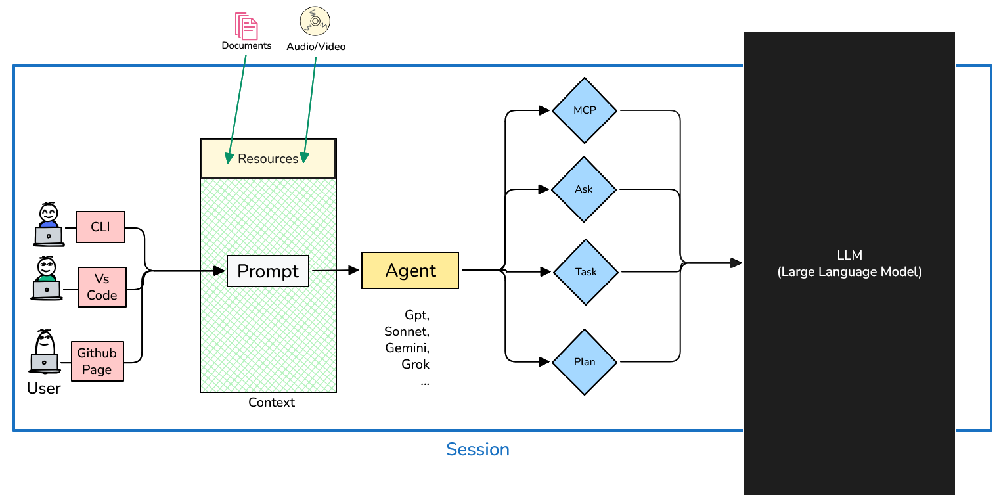
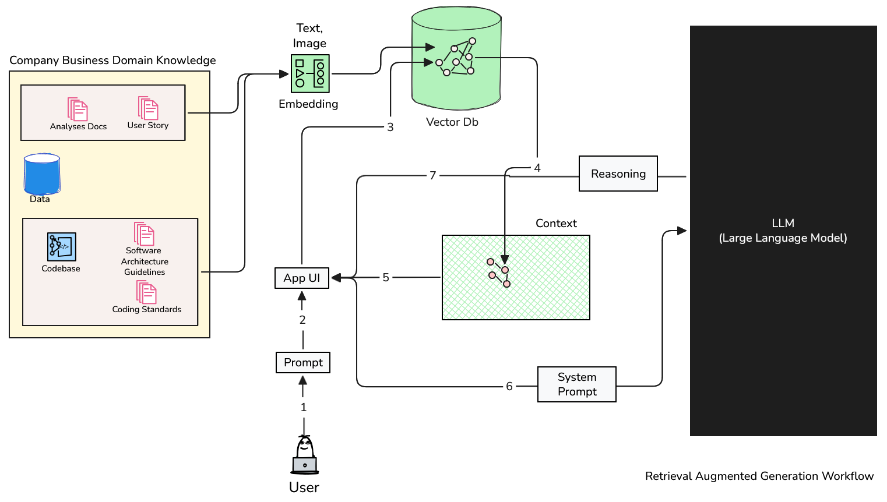
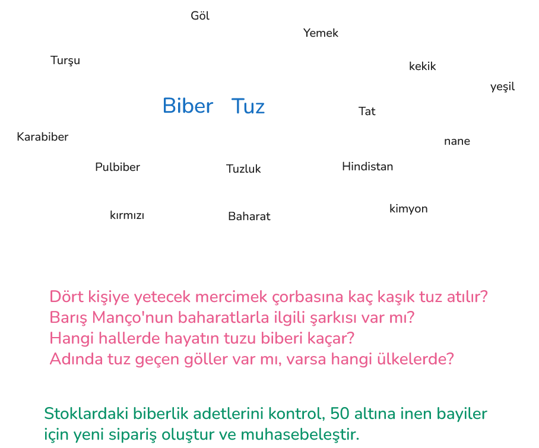

<a id="top"></a>

# Bölüm 09: RAG (Retrieval Augmented Generation) Yaklaşımı I

<!-- nav:top:start -->
[← Bölüm 08](chapter-08.md#top) · [İçindekiler](README.md#top) · [Bölüm 10 →](chapter-10.md#top)
<!-- nav:top:end -->

Yapay zeka tabanlı süreçlerde klasik akış aşağıdaki şekilde görüldüğü gibidir. Kullanıcılar bir **prompt** hazırlar ve yapay zeka modeline gönderirler. Model, verilen prompt'a göre bir çıktı üretir ve bu çıktı kullanıcıya geri döner. Günümüz yapay zeka modellerinin çoğu ön tarafta bir arayüz sağlar. Bu, basit bir chat penceresi olabileceği gibi geliştirme ortamındaki bir eklenti de olabilir. Tüm bu araçlar, kullanıcı ve yapay zeka dil modeli arasındaki oturum *(session)* sırasında sürece farklı materyallerin eklenmesine de olanak tanır. **Context** olarak da ifade edebileceğimiz bu bölümde yardımcı belgeler prompt ile birlikte dil modeline ulaşır.



Ne var ki genel dil modelleri önceden eğitilmiş verilerden ya da sağladığı araç desteği ile internet aramalarından yola çıkarak muhakeme *(reasoning)* sürecine girerler. Dil modelinin belli bir çerçevede çalışmasını istediğimiz durumlarda **context** içeriğini etkili bir şekilde hazırlamak da önemlidir. Kullanıcının isteğine konuyla ilgili ne kadar parça varsa dahil edilmesi, çıktının kalitesini artırabilir ve modelin daha iyi muhakeme yapmasına olanak tanır. Dil modellerinin deterministik olduğu ifade edilse de halüsinasyon görme ve bağlamı unutma eğilimleri vardır. Dolayısıyla aynı prompt için aynı dil modeli üzerinden farklı çıktılar üretilebilir. Sonuç aynı olsa da gidiş yolu ve detayda farklılaşmalar görülebilir. Bu nedenle bazı senaryolarda **RAG *(Retrieval Augmented Generation)*** yaklaşımını benimsemek daha iyi sonuçlar verebilir. **RAG** tekniğinde dil modeline verilen prompt'a ilaveten, modelin muhakeme yaparken kullanabileceği bir bilgi deposu da sağlanır. Bu bilgi deposu, modelin daha doğru ve tutarlı çıktılar üretmesine yardımcı olur. RAG yaklaşımında modelin, bilgi deposundan ilgili parçaları çekerek muhakeme sürecine dahil etmesi beklenir. Bu sayede, modelin deterministik olmayan doğası nedeniyle ortaya çıkabilecek tutarsızlıkların önüne geçilebilir ve daha kaliteli çıktılar elde edilebilir. Aşağıdaki şekilde bu kurgu basitçe ele alınmaktadır.



Bu yaklaşımda modelin kullanabileceği veri setinin vektörel olarak ifade edilişi çok önemlidir. Kavramlar arası yakınlıkların ölçümü için matematiğin doğasından yararlanılır. Herhangi bir paragrafın, bir terimin, kod tabanındaki semantik bir ifadenin ilişkili olduğu diğer parçaların tespitinde embedding araçlarından yararlanılarak mesafeler ölçülür. Modelin muhakeme sürecine dahil ettiği parçaların kalitesi, modelin ürettiği çıktının kalitesini doğrudan etkiler. Bu nedenle, bilgi deposunun iyi hazırlanması ve modelin bu bilgi deposundan doğru parçaları çekebilmesi için etkili bir vektörel ifade yöntemi kullanılması önemlidir. Bu da embedding modeline ve seçilen parçalama *(chunking)* stratejisine bağlıdır.

> Mesafeler genellikle **Kosinüs Benzerliği *(Cosine Similarity)*** veya **Öklid Mesafesi *(Euclidean Distance)*** gibi matematik yöntemlerle ölçülür ve vektörler arasındaki benzerlik veya uzaklık hesaplanır. Bu sayede, modelin bilgi deposundan çektiği parçaların prompt ile ne kadar ilişkili olduğu da değerlendirilebilir. Kosinüs benzerliği, iki vektör arasındaki açıyı ölçerken, Öklid mesafesi ise iki vektör arasındaki düz çizgi mesafesini ölçer. Hangi yöntemin kullanılacağı, uygulamanın ihtiyaçlarına ve veri setinin özelliklerine bağlı olarak değişebilir. Öklid uzaklığı *(Euclidean Distance)* iki nokta arasındaki fiziksel mesafeyi *(doğrudan uzaklığı)* ölçerken ve metnin uzunluğundan *(vektörün büyüklüğünden)* olumsuz etkilenirken; Kosinüs Benzerliği vektörlerin uzaydaki açısına *(yönüne)* bakar. Bu sayede biri çok uzun diğeri çok kısa ama aynı konudan bahseden iki metni **"birbirine çok benzer"** olarak doğru bir şekilde eşleştirebilir.

Derste işlediğimiz örnek senaryoda **Python** ile bir doküman setinin parçalanıp vektörel olarak ifade edilmesi, bu parçaların bir veritabanına kaydedilmesi adımı ele alınmıştır. **Text embedding** için **LM Studio** üzerinden host edilen **text-embedding-embeddinggemma-300m** kullanılmıştır. **Vektör** veritabanı olarak da **Rust** ile yazılmış olan **Qdrant** tercih edilmiştir. Parçalama stratejisi olarak da basitçe karakter sayısına göre bölme tekniği benimsenmiştir. Daha sofistike parçalama stratejileri de tercih edilebilir. Örneğin, doğal dil işleme teknikleri kullanarak cümle veya paragraf bazında bölme yapılabilir. Kod parçalarının bölünmesinde ise semantik analiz yaparak fonksiyon, sınıf veya modül bazında bölme yapılabilir. Parçalama stratejisi, modelin bilgi deposundan çektiği parçaların kalitesini etkileyebilir. Dolayısıyla parçalama stratejisinin dikkatli bir şekilde seçilmesi ve uygulanması önemlidir.

Bir vektör veritabanı hazırlandıktan sonra kullanıcılardan gelen prompt'lar da bir işleme tabi tutulur. Yani **prompt** için de bir vektör hesaplaması yapılır ve bu vektörün bilgi deposundaki diğer vektörlerle olan mesafeleri ölçülür. En yakın olan parçalar modele gitmeden önce sistem prompt'a dahil edilir. Modelin bu parçaları muhakeme sürecine dahil ederek daha kaliteli çıktılar üretmesi beklenir. Elbette sistem prompt'larının gönderilmesi sırasında alınması gereken tedbirler de olabilir. Bilgi deposundan çekilen parçaların kalitesini ölçmek, hassas bilgilerin istemeden de olsa gönderilmesini engellemek, modelin bu parçaları nasıl kullandığını izlemek gibi önlemler alınabilir *(Guardrails)*. Bu sayede, RAG yaklaşımının avantajlarından yararlanırken ortaya çıkabilecek risklerin de önüne geçilebilir.

> Bir modelin ürettiği çıktının firmanın kurumsal politikalarına uygunluğunu denetlemek ve veri sızıntılarını önlemek için [NeMo Guardrails](https://github.com/NVIDIA-NeMo/Guardrails) gibi güvenlik katmanları ele alınmalıdır.

Metinlerin birbirleriyle ilişkileri konusu aşağıdaki şekilde ele alınabilir. Ana kelimelerimiz **tuz** ve **biber** olarak belirlenmiştir. İlk akla gelen ilişkiler yemeklerle ve doğal olarak baharatlarla ilgilidir. Ancak coğrafi olarak tuz kelimesinin geçtiği **Tuz Gölü** ya da rahmetli **Barış Manço**'nun *Domates, Biber, Patlıcan* şarkısında geçen biber kelimesi ve hatta **hayatın tuzu biberi** ifadesi gibi farklı ilişkiler de ortaya çıkabilir. Modelin sorulan soruya göre doğru ilişkileri kurabilmesine yardımcı olabilecek düzenekler açısından bakıldığında, destekleyici bilgi depolarının kalitesi önemli hale gelir.



**RAG** burada özetlediğimiz kadarıyla iyi bir yaklaşım olsa da handikapları da vardır. En büyük sorunlardan biri, vektörel olarak yakın bulunan parçaların her zaman anlamsal olarak doğru cevabı içermemesidir. Bu nedenle vektör aramasından dönen sonuçların modele gitmeden önce belki bir re-ranking ile tekrar sıralanması gerekebilir.

## Bilgi Sağlama ve Bağlam (Context) Yönetimi

Yapay zeka dil modelleri ile çalışırken Context, Cache-Augmented Generation, Retrieval-Augmented Generation ve Model Context Protocol gibi kavramlarla karşılaşırız. Özellikle bağlamın kalitesini artırmak, modelin daha tutarlı ve doğru çıktılar üretmesini sağlamak için bu yöntemlere sıklıkla başvurulabilir. Ancak her bir yöntemi çeşitli kriterlere göre değerlendirmek gerekir. Aşağıdaki tabloda bu yöntemlerin bazı temel özellikleri karşılaştırılmıştır.

| **Özellik** | **Context** | **Cache-Augmented Generation** | **Retrieval-Augmented Generation** | **Model Context Protocol** |
| --------- | --------- | ----------------------------- | --------------------------------- | ------------------------- |
| **Çalışma Prensibi** | Tüm veriyi doğrudan prompt içine gömerek modele sunmak. | Devasa veriyi modelin önbelleğine *(Key-Value Cache)* tek seferde yükleyip, üzerinden işlem yapmak. | Veriyi vektörlere bölüp, sadece soruyla anlamsal eşleşen parçalarını modele sunmak. | Modelin dış sistemlere standart bir protokol ile bağlanıp anlık işlem yapmasını sağlamak. |
| **Kapasite** | Sınırlı *(Modelin token limiti kadar)* | Yüksek *(Modelin önbelleği kadar. 1, 2 milyon token)* | Sınırsız *(Vektör veritabanının kapasitesi kadar)* | Yüksek *(Modelin işlem yapabileceği her türlü veri kaynağı)* |
| **Maliyet ve Hız** | Her sorguda tüm veriyi baştan işlediği için yüksek maliyetli ve yavaş olabilir. | Veriyi tek seferde yükleyip, sonrasında hızlı işlem yapabilir. Ancak ilk yükleme maliyetlidir. | Sadece ilgili parçaları işlediği için genellikle daha hızlı ve düşük token maliyetlidir. | Modelin dış sistemlerle etkileşimine bağlı olarak değişkenlik gösterebilir. Genellikle hızlıdır ancak bu hız dış sistemlerin performansına bağlıdır. |
| **Mimari Gereksinim** | LLM'in kendisi | Geniş bağlam ve önbellek yetenekleri olan bir LLM | LLM + Embedding modeli + Vektör veritabanı | LLM + MCP Server + Dış sistemler |
| **Veri Güncelliği** | O an prompt'a dahil edilen veri kadar günceldir. | Önbellek *(Cache)* yenilenene kadar statik kalır, anlık olarak değişmez. | Vektör veritabanına yeni veri eklendikçe güncellenebilir. | Tamamen eş zamanlı ve canlıdır. |
| **Kullanım Senaryoları** | Kısa bir dokümanı özetlemek, birkaç sayfalık belgeyi incelemek, büyük olmayan kod parçalarını analiz etmek. | Çok sık değişmeyen büyük kurumsal yönetmelikler veya devasa statik kod tabanları. | Sürekli büyüyen ve değişen şirket analiz dokümanları, wiki'leri, geçmiş ticket aramaları. | Canlı veritabanından stok bilgisi çekme, GitHub'a kod gönderme, dosya I/O operasyonları |

Derste ele aldığımız uygulamayı **Claude Sonnet 4.6** modeline, **VS Code** arayüzünden aşağıdaki prompt'u vererek yazdırdık.

```text
Create a new terminal application written in Python. The purpose of this app is; Analyse documents, convert them into vectors via text embedding and store them into QDrant Db.

- Get source path from terminal.
- Use local LM Studio (hosting at http://127.0.0.1:1234)
- Use `text-embedding-embeddinggemma-300m` model.
- Use Qdrant as a vector database (Hosting at docker container)
- Measure the calculation time and give a summary result to user.
```

> Vektör veritabanını ve içerdiği koleksiyonları incelemek için `http://localhost:6333/dashboard/#/collections` adresine gidilebilir. Burada koleksiyonun içeriği, her bir parçanın hangi dokümana ait olduğu, vektörlerin boyutları vb. bilgilere erişilebilir. Ayrıca görsel graph diagramları ile parçaların birbirleriyle olan ilişkileri de incelenebilir.

<!-- nav:bottom:start -->
---

| ← Önceki Bölüm | İçindekiler | Sonraki Bölüm → |
| :--- | :---: | ---: |
| [Bölüm 08: Dağıtık Sistemler Hakkında Temel Bilgiler ve Basit Bir Senaryo Üzerinden İnceleme](chapter-08.md#top) | [İçindekiler](README.md#top) | [Bölüm 10: RAG (Retrieval Augmented Generation) Yaklaşımı II](chapter-10.md#top) |
<!-- nav:bottom:end -->
