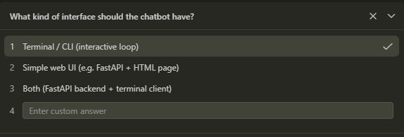
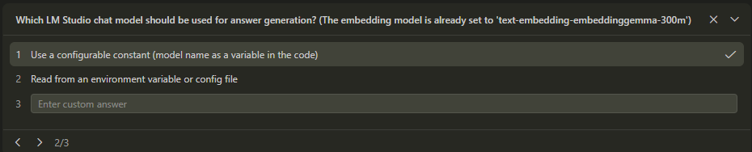
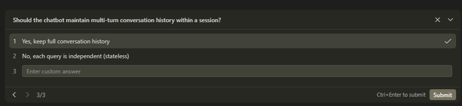
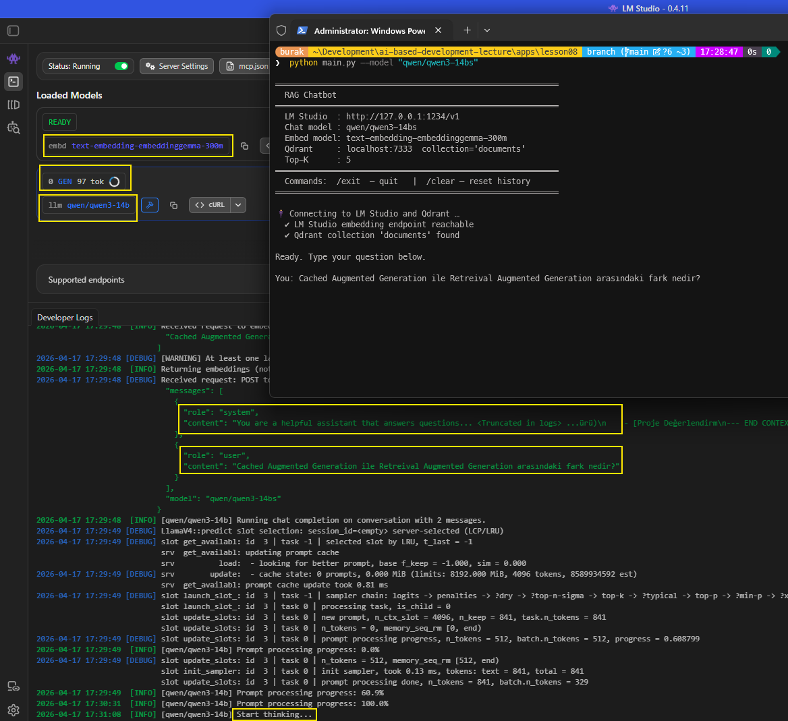

<a id="top"></a>

# Bölüm 10: RAG (Retrieval Augmented Generation) Yaklaşımı II

<!-- nav:top:start -->
[← Bölüm 09](chapter-09.md#top) · [İçindekiler](README.md#top) · [Bölüm 11 →](chapter-11.md#top)
<!-- nav:top:end -->

Bir RAG *(Retrieval Augmented Generation)* uygulaması yazmak için öncelikle bir bilgi deposu oluşturulması gerekir. Bu bilgi deposu, modelin muhakeme sürecine dahil edeceği parçaların saklandığı yerdir. Parçaların vektörel olarak ifade edilmesi ve bir veritabanına kaydedilmesinden sonra, kullanıcıların sorularını iletebileceği bir istemci uygulaması geliştirilir. Bu istemci *(Client App)*, kullanıcılardan gelen prompt'ları alır, bu prompt'lar için vektör hesaplaması yapar ve bilgi deposundan ilgili parçaları çekerek modelin muhakeme sürecine dahil eder *(Context Injection)*. Son aşamada modelin ürettiği çıktılar kullanıcıya döndürülür. Bu süreçte, modelin bilgi deposundan çektiği parçaların kalitesini ölçmek, hassas bilgilerin istemeden de olsa gönderilmesini engellemek, modelin bu parçaları nasıl kullandığını izlemek gibi önlemler alınabilir *(Guardrails)*. Bu sayede, RAG yaklaşımının avantajlarından yararlanırken ortaya çıkabilecek risklerin de önüne geçilebilir.

Bu dersimizde bir önceki derste geliştirilen **python** uygulamasını baz alarak bir istemci chatbot yazmaya çalıştık. Text embedding ve dil modeli için yine local ortamda çalışan **LM Studio** ortamına yüklenen modelleri kullandık. Vektör veritabanı olarak da yine docker üzerinden ayağa kaldırdığımız **Qdrant**'ı tercih ettik. Amacımız istemci tarafındaki setup'ı tamamlayarak, kullanıcıların sorularını alıp, bu sorulara göre bilgi deposundan ilgili parçaları çekip, modelin muhakeme sürecine dahil edip çıktılar üretmesini sağlamaktı. Yerel dil modellerimiz düşük kalitede ve kaynak olarak sadece bir markdown dosyası kullandığımız için sorulara verilen cevapların kalitesini görmezden geldik.

**lesson08** klasöründe yer alan uygulamayı yazdırmak için **Claude Sonnet 4.6** modeline **VS Code Copilot** arayüzünden aşağıdaki prompt'u verdik. *(Attachment kısmına lesson07 klasöründeki main.py dosyasını ekleyerek prompt'u verdik)*

```text
Create a new client app in lesson08 folder based on this python code.

Purpose: A chatbot application which is use RAG pipeline.
```

Daha önceki çalışmalardan farklı olarak bu sefer agent'ı **plan** modunda çalıştırdık. Plan modunda agent implementasyona başlamadan önce çoktan seçmeli bazı kritik sorular sorar. Bu sorulara verilen cevaplara göre bir taslak plan oluşturur. Bu plan, agent'ın nasıl ilerleyeceği konusunda bir yol haritası sağlar. Plan modunda çalışmak, özellikle karmaşık görevlerde agent'ın daha organize ve etkili bir şekilde hareket etmesine yardımcı olabilir. Yukarıda vermiş olduğumuz prompt oldukça basit ve genel bir ifadeye sahiptir. Buna göre agent bize üç soru sordu.

İlk soruda, istemci uygulamanın arabirimi hakkında bilgi istedi. Örneğin **CLI - Command Line Interface** mi yoksa **GUI - Graphical User Interface** mi olacağı gibi.



İkinci soru oldukça isabetliydi. Kullandığımız prompt içerisinde muhakeme yapacak dil modelini açıkça belirtmemiştik. Bu bilginin kodda değiştirilebilir olarak tutulması veya bir çevre değişken olarak konfigurasyondan gelmesine dair bir soruyla karşılaştık.



Son soruda ise konuşmanın aynı session içerisinde korunup korunmayacağı soruldu. Yani kullanıcının önceki sorularının ve modelin önceki cevaplarının hatırlanıp hatırlanmayacağı konusu gündeme geldi. Bu da bağlam yönetimi açısından önemli bir noktadır.



Buna göre yazılan **python** kodunun ilk denemesinde bir çalışma zamanı hatası aldık. Sorunu analiz etmek için **LM Studio** penceresine akan log bilgilerini de kullandık ve hatanın kaynağını tespit ettik. Görüldüğü kadarıyla **QdrantClient** nesnesinin **search** metodu paketin ilgili sürümünde değişmişti. Problemin çözümü için yine **Claude Sonnet 4.6** modeline aşağıdaki prompt'u verdik.

```text
There is a problem on runtime.

Reasoning Model: qwen/qwen3-14b
API Log:

2026-04-17 15:38:02 [INFO]
Received request to embed multiple: [
"What is the python?"
]
2026-04-17 15:38:02 [DEBUG]
[WARNING] At least one last token in strings embedded is not SEP. 'tokenizer.ggml.add_eos_token' should be set to 'true' in the GGUF header

App terminal output: [ERROR] 'QdrantClient' object has no attribute 'search'

Fix this error?
```

Yapay zeka modelleri ile çalışırken çözülmesini istediğimiz problemlerle ilgili kaliteli detaylar vermek önemlidir. Programatik ortamlarda üretilen log mesajları, exception/error nesneleri, hatanın oluştuğu andaki değişken değerleri gibi bilgiler, modelin problemi daha iyi anlamasına ve dolayısıyla daha isabetli çözümler üretmesine yardımcı olur.

İşte örneğimizi çalışma zamanında bir görüntü.

```bash
python main.py --model "qwen/qwen3-14bs"
```



RAG, yapay zeka modellerini bağlam kapsamında zenginleştirmenin yollarından sadece birisidir ve farklı türevleri vardır. Bu bölümde değerlendirdiğimiz klasik yaklaşım Vektör RAG olarak da bilinir. Bir diğer türü ise **Graph RAG** olarak geçmektedir. Diğer yandan yapay zeka ajanlarının bir RAG hattı ile ilişkilendirildiği **Agentic RAG** yaklaşımı da söz konusudur. Süre gelen gelişmeler düşünüldüğünde farklı mimari çözümlerin de ortaya çıkması muhtemeldir. Ancak tüm bu yaklaşımlarda temel odak noktası, dil modelinin bağlam *(context)* kapsamını zenginleştirerek daha kaliteli çıktılar üretmesini sağlamaktır.

- Bknz: [Bölüm 11 - Klasik RAG, Graph RAG ve Knowledge Graph'ler](chapter-11.md#klasik-rag-graph-rag-ve-knowledge-graphler)

<!-- nav:bottom:start -->
---

| ← Önceki Bölüm | İçindekiler | Sonraki Bölüm → |
| :--- | :---: | ---: |
| [Bölüm 09: RAG (Retrieval Augmented Generation) Yaklaşımı I](chapter-09.md#top) | [İçindekiler](README.md#top) | [Bölüm 11: RAG'ın Ötesi: Graph RAG, Knowledge Graph, CAG ve KAG](chapter-11.md#top) |
<!-- nav:bottom:end -->
