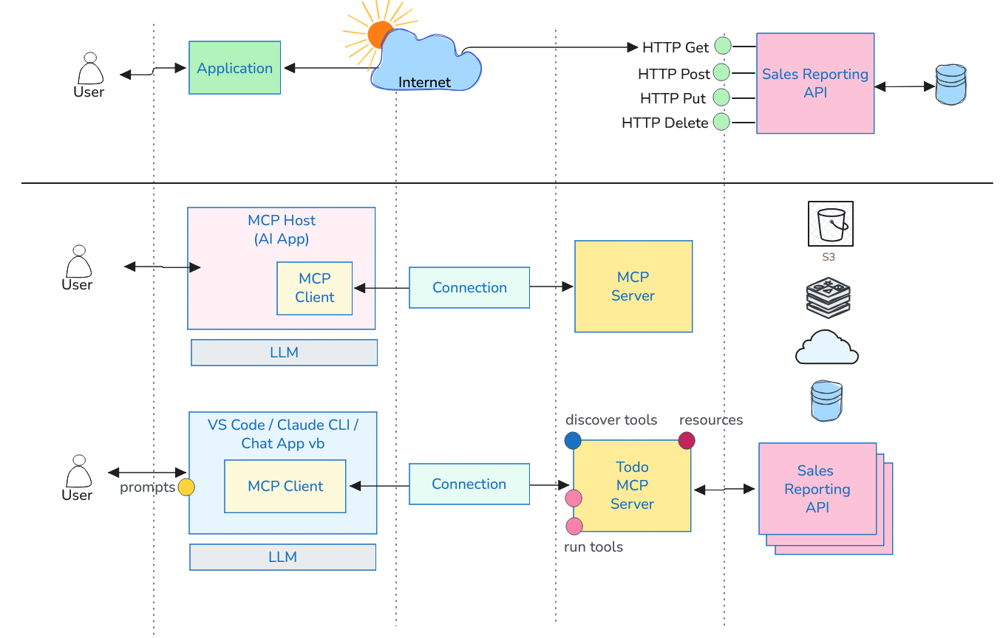

# Bölüm 12: MCP (Model Context Protocol) Kavramı ve MCP Server Yazılması

<!-- nav:top:start -->
[← Bölüm 11](chapter-11.md#top) · [İçindekiler](README.md#top) · [Bölüm 13 →](chapter-13.md#top)
<!-- nav:top:end -->

Klasik bir Web API hizmetini göz önüne alalım. Bu senaryoda bir istemcinin JSON, XML gibi standart formatlarda veri gönderip alması söz konusudur. İstemci *(client)* ve sunucu *(server)* arasındaki iletişim genellikle HTTP protokolü üzerinden gerçekleşir. İstemciler sunucu üzerindeki belirli endpoint'lere istek gönderir. REST mimarisi açısından bakıldığında bu endpoint'ler genellikle kaynaklara karşılık gelir ve HTTP metodlarıyla *(GET, POST, PUT, DELETE gibi)* işlem yapılır. Bu süreçte istemciler genellikle sunucunun sunduğu API'leri keşfetmek ve kullanmak için dokümantasyonlara başvururlar.

Yapay zeka asistanları da benzer bir şekilde harici araçlara erişmek istediklerinde, bu araçların nasıl kullanılacağını anlamak için keşifte bulunmak durumundadırlar. Bu keşifle hangi araçları kullanabileceklerini ve bu araçlarla nasıl etkileşim kurabileceklerini öğrenirler. İşte bu noktada **Model Context Protocol (MCP)** devreye girmektedir.

**MCP (Model Context Protocol)**, yapay zeka araçlarına standart bir yolla harici araç *(tool)* desteği sunmak amacıyla **Anthropic** tarafından geliştirilmiş bir protokoldür. Bu protokol sayesinde yapay zeka asistanları, önceden tanımlanmış araç setlerini otomatik olarak keşfedebilir ve belirli bir çerçeve içerisinde çeşitli işlemleri *(örneğin arka plandaki REST API'leri çağırarak veri okuma veya tetikleme işlemleri)* gerçekleştirebilir. Bu yapı sayesinde yapay zeka modelleri sadece kendi öğretildikleri durağan veri setlerine bağlı kalmaktan kurtulur; ihtiyaç duydukları güncel ve kaliteli bağlama *(context)* MCP sunucuları üzerinden güvenle erişebilirler.

Genel mimaride üç temel bileşen yer alır: **MCP Host** *(VS Code AI asistanları, GitHub CLI vb. gibi uygulamalar)*, **MCP Client** *(bağlantı ve bağlam yönetimini üstlenen istemci)* ve **MCP Server** *(istemcilere araç seti sunan servis)*.

MCP sunucuları ne tür senaryolarda kullanılabilir?

- Canlı veritabanlarından bilgi çekme: Örneğin, bir e-ticaret sitesinin stok durumunu gerçek zamanlı olarak sorgulamak, yorumlatmak, öngörü almak.
- Harici API'lerle entegrasyon: Örneğin hisse senedi işlemleri yapan bir uygulamada, gerçek zamanlı borsa verilerini çekmek veya bir ödeme sağlayıcısının API'sini kullanarak ödeme işlemi gerçekleştirmek.
- Bir dosya sisteminde belirli bir dosyanın içeriğini okumak veya yazmak.
- Diğer araçlarla entegrasyon: Örneğin, bir CI/CD aracını tetikleyerek bir dağıtım *(deployment)* sürecini başlatmak.

gibi pek çok senaryoda **MCP** sunucuları devreye girebilir. Burada kafa karıştırıcı nokta, söz konusu operasyonları MCP arkasındaki araçlarla doğrudan iletişime geçerek yapabiliyor olmamızdır. Aradaki fark şudur; **MCP** sunucuları, yapay zeka asistanlarının bu araçları keşfetmesine ve kullanmasına olanak tanır. Böylece bir yapay zeka asistanının API'nin izin verdiği çerçevede hareket edebilmesi ve dolayısıyla daha kontrollü bir bağlam üzerinden işlem yapması sağlanabilir.

Bir MCP sunucusunu geliştirme ortamlarında, CLI araçlarında veya diğer uygulamalarda kullanmak mümkündür. Klasik olarak girilen bir prompt, içeriğine göre uygun MCP sunucusu ile eşleştirilir ve bu sunucu üzerinden gerekli araçlar çağrılarak işlem gerçekleştirilir *(VS Code arabirimindeki Extensions sekmesinde `@mcp` etiketiyle arama yaparak MCP birçok mcp sunucusu keşfedilebilir)*.

.NET platformunda bir MCP sunucusu geliştirmek için `ModelContextProtocol` NuGet paketi oldukça pratik bir kullanım sunar. Sınıflara `[McpServerToolType]` ve metotlara `[McpServerTool]` nitelikleri *(attributes)* eklenerek fonksiyonlar, parametre açıklamalarıyla birlikte yapay zekaya tanıtılır. Hazırlanan bu sunucu `mcp.json` dosyası üzerinden VS Code gibi editörlere entegre edildiğinde, Copilot gibi bir asistan kullanıcının doğal dil sorgularını yorumlayıp gerekli arka plan araçlarını uygun argümanlarla kolayca çalıştırabilir.

> .NET platformunda bir MCP sunucusu geliştirmekle ilgili [şu yazıya](https://buraksenyurt.github.io/2026/03/07/microsoft-dotnet-platformunda-bir-mcp-server-yazmak/) bakılabilir.

**MCP** standardı güncel olarak üç tip veri taşıma *(Transport)* mekanizmasını destekler: Standard Input/Output *(Stdio)*, **[SSE](https://www.utcp.io/protocols/sse) *(Server-Sent Events)*** ve **[Streamable HTTP](https://www.utcp.io/protocols/streamable-http)** *(Mart 2025'te HTTP ve SSE kullanımının alternatifi olarak eklenmiştir)*.

- **Stdio:**
  - **Çalışma şekli;** İstemci taraf *(Vs Code, Copilot CLI vb.)* ile MCP sunucusu arasında veri alışverişi, standart giriş/çıkış akışları üzerinden gerçekleşir. MCP sunucusu arka planda bir alt process olarak çalışır ve veri iletimi JSON-RPC mesajları ile gerçekleşir.
  - **Avantajları;** Kurulumu ve entegrasyonu genellikle daha basittir, özellikle yerel geliştirme ortamlarında hızlıca test etmek için idealdir, ağ yapılandırması gerektirmez, port çakışması olmaz veya güvenlik duvarı sorunları yaşanmaz.
  - **Dezavantajları;** Sadece yerel kullanım için uygundur, uzak sunucularla iletişim kurmak mümkün değildir, ölçeklenebilirlik sınırlıdır, yüksek trafik altında performans sorunları yaşanabilir.
  - **Kullanım senaryoları;** Sunucu ve istemcinin aynı makinede çalıştığı durumlar, hızlı prototipleme ve geliştirme süreçleri, basit araç entegrasyonları.
- **SSE (Server-Sent Events):**
  - **Çalışma şekli;** MCP sunucusu bir Web API olarak çalışır. İstemci sunucuya HTTP üzerinden bir bağlantı açar ve sunucu, SSE protokolünü kullanarak istemciye asenkron mesajlar gönderir.
  - **Avantajları;** Ağ üzerinden çalışır. Dil modeli nerede olursa olsun internet veya intranet üzerinden bağlanabilir.
  - **Dezavantajları;** Kurulumu ve entegrasyonu daha karmaşıktır. Araya bir ağ katmanı girdiğinden gecikmeler *(latency)* olabilir ve daha da önemlisi authentication/authorization eklemek gerejir, çünkü aksi halde herhangi biri sunucuya bağlanıp araçları kullanabilir.
  - **Kullanım senaryoları;** Genellikle canlı güncellemeler *(live updates)* veya gerçek zamanlı bildirimler *(notifications)* gerektiren durumlarda ya da feed akışlarında kullanılır. Internet veya intranet üzerinden merkezi bir MCP sunucusuna ihtiyaç duyulan durumlar, birden fazla istemcinin aynı MCP sunucusunu kullanacağı senaryolar için uygundur.
- **Streamable HTTP:**
  - **Çalışma şekli;** İstemci ve sunucu haberleşmesi tek bir HTTP endpoint üzerinden yapılır. Kısa süreli işlemlerde standart bir **HTTP Request/Response** gibi davranırken, büyük boyutlu ve uzun sürecek akışlarda otomatik olarak **SSE** benzeri kesintisiz bir stream'e dönüşebilir.
  - **Avantajları;** Gerçek anlamda çift yönlü *(bidirectional)* iletişim sağlar, tek bir endpoint üzerinden hem kısa hem de uzun süreli işlemleri destekler, bağlantı kopuşlarında kaldığı yerden devam edebilir, iptal edilebilirlik özelliği sunar.
  - **Dezavantajları;** SSE'de olduğu gibi ağ üzerinden bir iletişim söz konusu olduğundan authentication/authorization eklemek gerekir.
  - **Kullanım senaryoları;** Büyük boyultu veri akışlarının parçalar halinde eline alınacağı senaryolar için idealdir. Bu nedenle MCP tarafında özellikle araçların çıktılarının uzun olabileceği durumlarda Streamable HTTP tercih edilmektedir. Örneğin bir araç, büyük bir veri setini analiz ediyor ve sonuçları parça parça döndürüyor olabilir. Bu durumda Streamable HTTP, istemcinin bu parçaları gerçek zamanlı olarak almasını sağlar.

<!-- nav:bottom:start -->
---

| ← Önceki Bölüm | İçindekiler | Sonraki Bölüm → |
| :--- | :---: | ---: |
| [Bölüm 11: RAG'ın Ötesi: Graph RAG, Knowledge Graph, CAG ve KAG](chapter-11.md#top) | [İçindekiler](README.md#top) | [Bölüm 13: MCP Server'lar ile Çalışmak](chapter-13.md#top) |
<!-- nav:bottom:end -->
