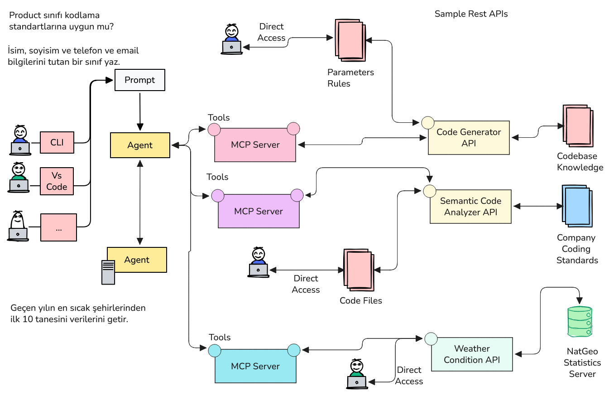
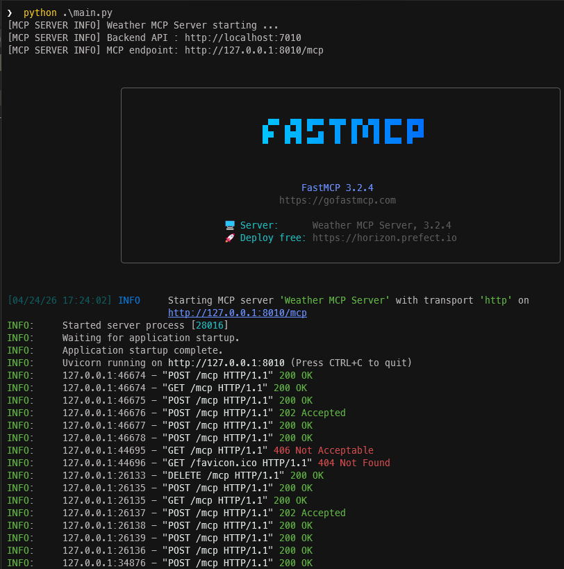
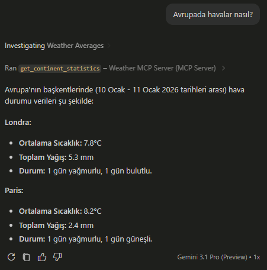

<a id="top"></a>

# Bölüm 13: MCP Server'lar ile Çalışmak

<!-- nav:top:start -->
[← Bölüm 12](chapter-12.md#top) · [İçindekiler](README.md#top) · [Bölüm 14 →](chapter-14.md#top)
<!-- nav:top:end -->



[Nodejs tabanlı API Servisi](apps/lesson10/WeatherApi/WeatherStatisticApiDesign.md) ve bunu oluşturmak için kullanılan prompt *(Plan modu. Attachment olarak tasarım dokümanı eklenmiştir)*

```text
Create a nodejs based rest api service by using this design document.
```

[Python tabanlı MCP Server Projesi](apps/lesson10/WeatherMCPServer/WeatherMCPServerDesign.md) ve oluşturmak için kullanılan prompt *(Plan modu. Attachment olarak tasarım dokümanı eklenmiştir)*

```text
Create an MCP Server application by using Python. Use HTTP Streaming protocol. Discover required tools according to backend API service.
```

Örnek senaryoyu işletmek için öncelikle **WeatherApi** projesini çalıştırmak gerekir. Bu proje, hava durumuyla ilgili istatistikleri sağlayan bir REST API hizmetidir. **Nodejs** ile yazılmış program kodu aşağıdaki gibi çalıştırılabilir.

```bash
npm run dev
```

Bu servisi kullanan **MCP Server** ise **python** ile yazılmış olup **FastMCP** kütüphanesini kullanır. **Stremable HTTP** protokolüne göre çalışan MCP Server'ı terminalden aşağıdaki komutlarla çalıştırabiliriz.

```bash
python .\main.py
```



Çalışan MCP server ile VS Code arabirimi üzerinden konuşabilmek için **mcp.json** dosyasına aşağıdaki bildirimi yapmamız gerekir.

```json
{
 "servers": {
  "Weather MCP Server": {
   "url": "http://localhost:8010/mcp",
   "type": "http"
  }
 }
}
```

Sonrasında herhangi bir ajanı kullanarak bu MCP sunucusunu keşfedebilir ve kullanabiliriz.



> Bir başka MCP server örneği de [Log Loki MCP Server](apps/log-mcp-lab/docs/mcp-server.md) olabilir. İlgili klasörde örnek uygulama, setup düzeneği ve çıktılara da yer verilmektedir.

<!-- nav:bottom:start -->
---

| ← Önceki Bölüm | İçindekiler | Sonraki Bölüm → |
| :--- | :---: | ---: |
| [Bölüm 12: MCP (Model Context Protocol) Kavramı ve MCP Server Yazılması](chapter-12.md#top) | [İçindekiler](README.md#top) | [Bölüm 14: Custom Agent, Skill ve Plugin Yapıları ile Çalışmak](chapter-14.md#top) |
<!-- nav:bottom:end -->
