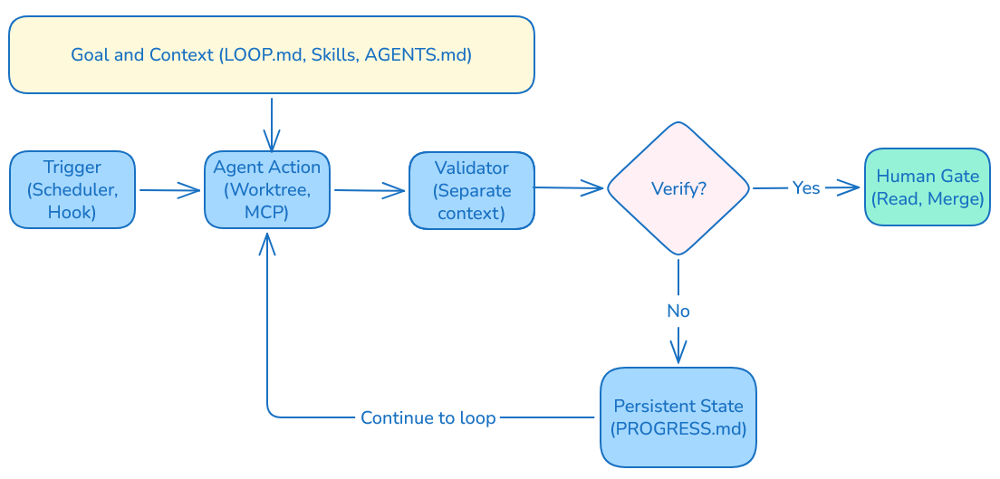
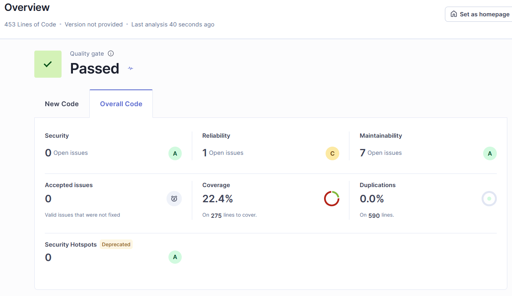
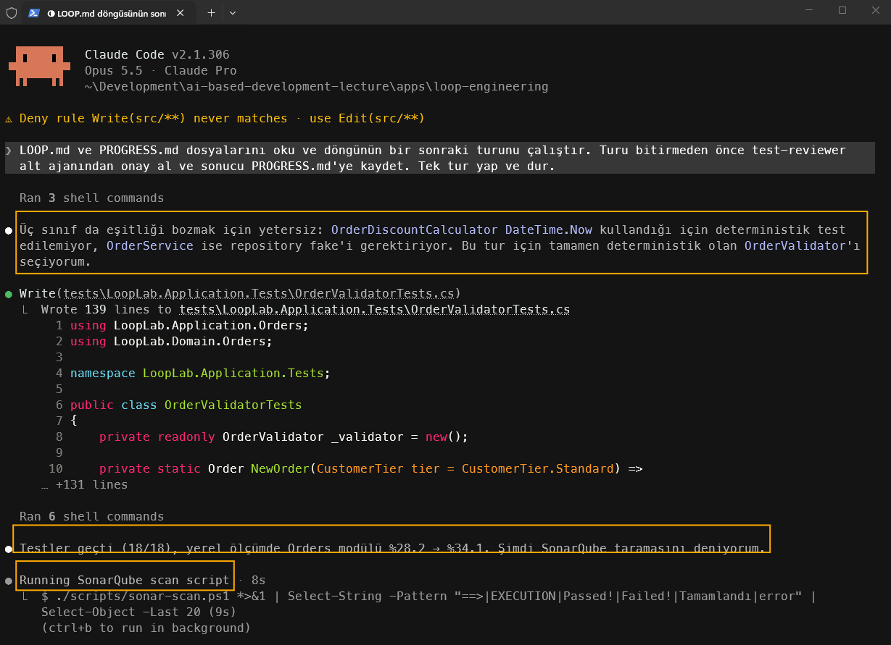
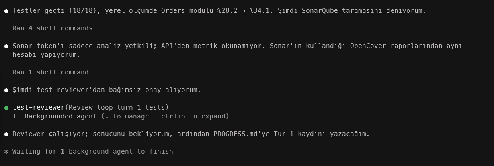
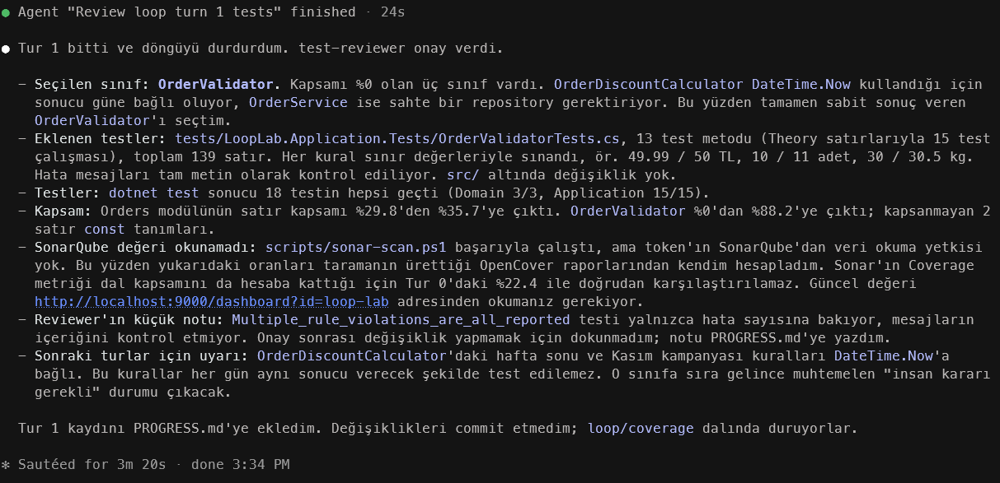
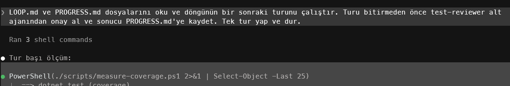
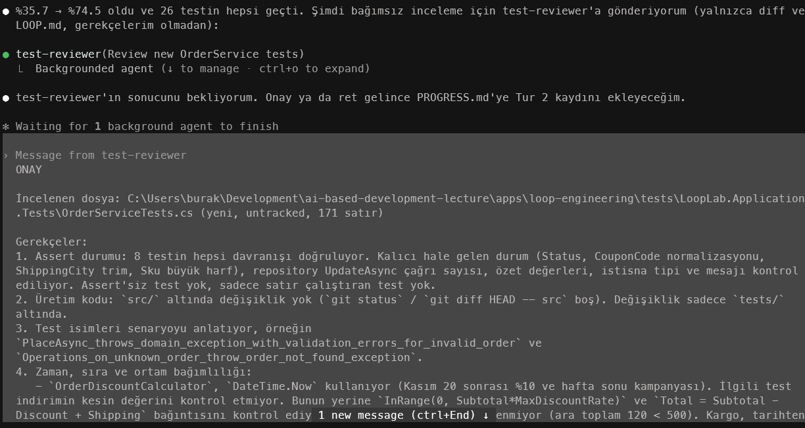

<a id="top"></a>

# Bölüm 15: Döngü Mühendisliği (Loop Engineering)

<!-- nav:top:start -->
[← Bölüm 14](chapter-14.md#top) · [İçindekiler](README.md#top) · [Bölüm 16 →](chapter-16.md#top)
<!-- nav:top:end -->

Sürekli gelişmekte olan yapay zeka mühendisliğinin önemli konularından birisi de `Loop Engineering`'dir. Temelde ajanların her adımda bizden komut alarak ilerlediği klasik prompt mühendisliği yaklaşımı yerine bu teknikte bir hedefe göre güdümlenen ajan, görev icra eder, çıktıları değerlendirir, kontrol eder ve gerekiyorsa bir sonraki adıma karar verip süreci tekrarlar. Yani en iyi promptu yazmak yerine bir ajanı ölçülebilir bir hedefe götüren döngünün tasarlanması ve optimize edilmesi ön plana çıkar. Aslında Loop Engineering öncelikleri ortadan kaldırmaz, onları sarmalar ve sürekli iyileştirme döngüsü ile hedefe ulaşmayı kolaylaştırır. Her katman bir alttakini içerir. Bunu aşağıdaki tablo ile özetleyebiliriz.

| **Katman** | **Neyi Tasarlarız?** | **İnsan Rolü** | **Beklenen Çıktı** |
| --- | --- | --- | --- |
| **Prompt Engineering** | Sadece bir talimat tasarlanır | Her isteği yazarız, sonucu değerlendiririz | Bir cevap ya da kod parçası |
| **Context Engineering** | Modelin gördüğü tüm bağlamı tasarlarız. Specs, örnekler, belgeler, geçmiş | Bağlamı seçer ve düzenleriz | Modelin daha tutarlı tek tur sonuçlar vermesi beklenir |
| **Harness Engineering** | Tek bir ajanın çalışma ortamı hazırlanır. İhtiyaç duyduğu araçlar, dosya sistemi, gerekli izinler ve kurallar belirlenir | Ajanın sınırlarını belirlerliz | Kendi araçlarıyla işi bitiren bir ajan çalışması beklenir |
| **Loop Engineering** | Ajanı tetikleyen, kontrol eden ve sıradaki işe yönlendiren sistemi tasarlarız | Hedefi belirler, kabul kriterlerini koyar ve döngüyü denetleriz | Hedefe ulaşana kadar tekrar eden ve state'i saklayan bir süreç |

Döngü mühendisliği aşağıdakine benzer bir akış içerir.



Döngünün temel ritmi; eylem *(action)*, gözlem *(observation)*, ayar *(adjustment)* ve tekrarlama *(repeat)* şeklindedir. Döngü koşul *(ya da ölçüt)* sağlanana kadar devam eder ve bizim tarafımızddan değerlendirmenin yapıldığı son kapıya gelir. Ölçüt sağlanamadığında döngü o anki durumu *(state)* kaydeder ve yeni tura başlar. Sürecin parçlarını aşağıdaki tablo ile değerlendirebiliriz.

| **Parça** | **Ne işe yarar?** | **Karşılığı nedir?** | **Yoksa ne olur?** |
| --- | --- | --- | --- |
| **Verifiable Goal *(Doğrulanabilir hedef)*** | Döngünün ne zaman duracağını söyleyen ölçüt | Geçen test sayısı, temiz lint raporu, kapsama oranı *(test coverage)* gibi metrikler | Ajan sonsuz döngüye girebilir ya da ilk iterasyonda hatalı bir state ile durabilir |
| **Tetikleyici *(Trigger)*** | Döngüyü insana ihtiyaç duymadan başlatan olay veya koşul | Zamanlanmış görevler *(scheduled jobs)*, CI/CD olayları, webhook'lar, dosya değişiklikleri, agent hook'ları | Tetikleyici yoksa döngü hiç başlamaz ya da manuel olarak başlatılması gerekir |
| **Bağlam ve Kalıcı Durum *(Context and Persistent State)*** | Proje bilgisini ve önceki turların sonuçlarını taşır | Modelin gördüğü tüm bağlam, önceki çıktılar, geçmiş iterasyon verileri, skill'ler, `CLAUDE.md` veya `AGENTS.md` gibi ajan spec'leri | Bağlam eksikse her tur sıfırdan tahmin yürütülür ve asıl amaca ulaşmaktan uzaklaşılabilir |
| **Araçlar *(Tools)*** | Döngü sırasında kullanılan yazılım ve donanım bileşenleri. Ajanın gerçek sisteme dokunmasını sağlayan şeyler olarak düşünülebilir. | API'ler, MCP sunucuları, CLI komutları | Ajan sadece metin üretmekle yetinir ve sonuçları sınayamaz |
| **İzolasyon *(Isolation)*** | Paralel çalışan ajanların birbirlerini ezmemesi için önemlidir | git worktree, sandbox gibi izole container ortamları | Ayrı bağlamlarda çakışan değişiklikler olabilir |
| **Alt ajan doğrulayıcılar *(Sub-agent Checkers)*** | Yazan ile denetleyen ajanların ayrılması | Ayrı bir context'te çalışan review ajanı | Ajan kendi işini denetleyemez ve hataları gözden kaçırabilir |

Bu teknikte döngünün kalbi ölçüm ve değerlendirmedir. Hedef makinenin doğrulayabileceği türden ölçütler belirlenir ve her iterasyonda bu ölçütler üzerinden değerlendirme yapılır. Aşağıdaki örnek içeriği değerlendirebiliriz.

**Yetersiz tanımlama;**

```text
Kodu daha temiz hale getir.
```

**Olması gereken;**

```text
src/Products altındaki tüm testler geçene, SonarQube'da yeni critical bulgu kalmayana ve cyclomatic complexity 10'u aşan metot sayısı sıfıra inene kadar devam et. 8 turda ulaşamazsan dur ve neyin engel olduğunu raporla.
```

> İyi bir hedef tanımının üç özelliği vardır; Ölçülebilir bir kabul kriteri, bir durma koşulu ve birde kaçış yolu. Özellikle kaçış kapısı olmayan bir döngü sonsuz döngüye yol açabilir ve bu da token tüketimini gereksiz yere artırabilir.

Dikkat edilmesi gerken birkaç nokta vardır. Örneğin bu yaklaşımda yazan ve denetleyen ajanların ayrı olması tercih edilir. Zira bu klasik bir yaklaşımdır; *kodu yazan kişi ile PR'ı onaylayan kişi aynı olmamalıdır* felsefesi burada da geçerlidir. Doğrulama işini genelde bir alt ajan *(sub-agent)* üstlenir ve asıl yazan akanın gerekçelerini değil sadece kabul ölçütlerini ve diff sonuçlarını değerlendirir. Bir diğer husus bizim yani insanın rolüdür. İnsan bu döngünün dışına itilemez, mutlaka döngünün kritik kapılarına yerleştirilir. Örneğin hedefi koyan, kabul ölçütünü onaylayan, merge öncesi çıktıları değerlendiren kişi insan olmalıdır. İç döngü ajanların kendi alanıyken dış döngü tamamen insanın kontrolündedir.

Döngü mühendisliğinin altında yatan fikirlerin hepsi zaten var olan yazılım geliştirme pratiklerinden esinlenmiştir.

| **Klasik Pratik** | **Süreç** | **Döngü Mühendisliği Karşılığı** |
| --- | --- | --- |
| **Test Driven Development (TDD)** | Red -> Green -> Blue | Testler geçene kadar iterasyonu devam ettiren ajan. Testler kabul ölçütüdür |
| **Code Review** | Pull Request -> Review -> Approve *(Yazan kişi ile onaylayan aynı kişi değildir)* | `Maker/Checker` ayrımı ve doğrulayıcı alt ajan. |
| **Continuous Integration (CI)** | Commit -> Build -> Test -> Report | Bir olay ile tetiklenen döngü, red build bir sonraki iterasyonun girdisi olur |
| **Cron Jobs** | Belirli aralıklarla tetiklenen işler | Zamanlanmış ajan görevleri |
| **OODA *(Observe, Orient, Decide, Act)*** | Gözlemle -> Yönlendir -> Karar Ver -> Uygula | Ajanın döngünün her iterasyonunda gözlem ve karar adımlarını işletmesi |
| **PDCA *(Plan, Do, Check, Act)*** | Planla -> Uygula -> Kontrol Et -> Önlem Al | Döngü mühendisliğinde iteratif iyileştirme süreci, her iterasyonda planlama, uygulama, kontrol ve önlem adımlarının işetilmesi |

Dolayısıyla yukarıdaki tabloda bahsedilen disiplinler iyi bir döngü mühendisliği için temel yapı taşlarını oluşturur. Temiz kod, test kapsamı ve statik kod analizi konularını ele aldığımız bölümler bu nedenle oldukça önemlidir.

Döngü mühendisliği oldukça etkili bir yaklaşımdır ancak gizlediği bazı maliyetler de vardır. İyi tasasrlanan bir döngü kod üretimini neredeyse bedava hale getirir ama bunun da bir bedeli olur. Özellikle teknik borç kavramına daha önceden de sıkça değindiğimiz için burada olası diğer borç türlerini tanıtmakta fayda vardır.

| **Borç/Maliyet** | **Tanım** | **Nasıl olur?** | **Nasıl ödenir?** |
| --- | --- | --- | --- |
| **Teknik Borç *(Technical Debt)*** | Yazılım geliştirme sürecinde alınan kısa vadeli kararların uzun vadede ek maliyet yaratması | Kasıtlı olarak da biriktirilebilir ama genellikle farkında olmadan birikir ve ileride çözülmesi gereken ek işler yaratır | Refactoring ve planlı iyileştirmeler |
| **Anlama Borcu *(Comprehension Debt)*** | Sistemin yaptığı ile ekibin anladığı arasındaki fark olarak ifade edilebilir. | Sinsice oluşur. Kod testleri geçtiği için kimse tarafından okunmaz | Döngünün ürettiğini okumak, ajana değişikliği açıklatmak, ufak diff kayıtları eklettirmek |
| **Niyet Borcu *(Intent Debt)*** | Kararların gerekçesinin hiçbir yere yazılmamış olması | Her turda ajan aynı niyeti yeniden tahmin eder, bazen farklı tahmin eder | Skills, AGENTS.md, ADR dökümanları ile niyeti bir kez yazıp kalıcılaştırmak |
| **Doğrulama Borcu *(Verification Debt)*** | Üretim hızının denetim kapasitesini aşmasıdır ve çok yaygın görülür | Ajan sayısı ve döngü iterasyon sıklığı arttıkça oluşur | Otomatik kabul ölçütleri koyulabilir, insan kapılarını *(Human Gates)* azaltmak değil hedeflemek düşünülmelidir |
| **Token Patlaması *(Token Blowout)*** | Alt ajanların ve sık iterasyonların maliyeti katlamasıdır | Durma koşulu olmayan ya da zayıf döngüler | Döngü için tur sınırı, token bütçesi belirlenmesi ve mutlaka maliyetin izlenmesi |
| **Bilişsel Teslimiyet *(Cognitive Surrender)*** | Model bazlı muhakemelerin de döngüye devredilmesidir | Zaten döngü hallediyor rahatlığıyla oluşur | Dış döngünün sahibinin insan olduğunu unutmamak, korumak ve kararları insanın vermesini sağlamak |

Teknik borç anladığımız ama keşke daha iyi yazsaydık dediğimiz türden bir borçlanma iken anlama borcu *(Comprehension Debt)* kod üzerinden kimsenin akıl yürütemediği kodlar için söz konusudur. Döngü ne kadar iyi çalışırsa anlama borcu o kadar hızlı büyüyebilir zira kötü çalışan döngünün çıktısına zaten bakarız fakat iyi çalışanınkine bakmayı bir süre sonra bırakabiliriz.

## Örnek Senaryo

Döngü mühendisliği konusunu daha iyi anlamak için basit bir senaryo üzerinden ilerleyelim. Elimizde şöyle bir senaryo olsun;

```text
Test kapsamı %25 civarında olan eski bir sipariş servisini ele alalım. Amacımız, her gece çalışan ve kapsamı adım adım artıran, her turu küçük bir pull request ile bitiren bir döngü kurmak.
```

İlk olarak `LOOP.md` dosyasını oluşturalım. Burada ölçüt, durma koşulu ve yasakları tanımlayacağız.

```markdown
# Hedef
src/Orders modülünde satır kapsamını %70'e çıkar.

# Her turda
- Kapsamı en düşük `TEK` sınıfı seç.
- Sadece test ekle; üretim koduna dokunma.
- Testler geçmeli, mevcut hiçbir test kırılmamalı.
- Değişiklik 300 satırı geçmesin.

# Dur
- Hedefe ulaşınca, `VEYA`
- Aynı sınıfta 2 tur üst üste ilerleme yoksa, `VEYA`
- Test edilebilmesi için üretim kodu değişmesi gerekiyorsa (bunu `PROGRESS.md`'ye "insan kararı gerekli" olarak yaz).
```

İkinci olarak döngünün her bir turunda olanları kayıtl altına alınacağı bir `PROGRESS.md` dosyası oluşturalım. Bu sayede döngü kendi geçmişini tutup hatırlayabilir.

```markdown
## Tur 7 - 2026-10-20
Sınıf: OrderDiscountCalculator
Kapsam: %41 → %46 (modül geneli)
PR:`#118`
Not: Tarih bağımlılığı var, IClock arayüzü yok. İnsan kararı gerekli.
```

Doğrulama işlerinin ayrı bir ajan tarafından yapılmasını önermiştik. Bu senaryo için `test-reviewer.md` isimli bir dosya ile söz konusu alt ajanı tanımlayabiliriz. Claude ortamında bu dosya `.claude/agents/test-reviewer.md` olarak yazılır. Aşağıdaki gibi bir içeriğe sahip olabilir.

```markdown
---
name: test-reviewer
description: Döngünün eklediği testleri bağımsız olarak denetler
tools: Read, Grep, Bash
---
Sen bir test inceleme uzmanısın. Sadece diff'e ve LOOP.md'ye bak.
Şunları kontrol et:
- Testler gerçekten davranışı mı doğruluyor, yoksa sadece
  satırları mı çalıştırıyor (assert'siz test var mı)?
- Üretim koduna dokunulmuş mu?
- Test isimleri senaryoyu anlatıyor mu?
Çıktın sadece ONAY veya RED ve gerekçe listesi olsun.
```

Döngünün önemli parçalarından birisi de nasıl başlatılacağı ve nasıl denetleneceğidir. Bunun için tetikleyiciler *(trigger)* ve kancalar *(hook)* kullanılır. Söz gelimi gece çalışan zamanlanmış bir görev döngüyü başlatabilir, ajan durmaya çalıştığında ise bir hook kabul kriterlerini tekrar kontrol edebilir. Claude ekseninden düşünürsek bu tür ayarları `.claude/settings.json` dosyasında tutarız. Örnek çözümümüzde bu iş için `scripts/check-loop-goal.ps1` betiğini kullanıyoruz *(detaylarına [Döngüyü Otomatikleştirmek](#döngüyü-otomatikleştirmek) kısmında değineceğiz)*.

```json
{
  "hooks": {
    "Stop": [
      {
        "hooks": [
          {
            "type": "command",
            "command": "powershell.exe",
            "args": ["-NoProfile", "-ExecutionPolicy", "Bypass", "-File",
                     "${CLAUDE_PROJECT_DIR}/scripts/check-loop-goal.ps1"]
          }
        ]
      }
    ]
  }
}
```

`Stop` olayı, ajan durmaya çalıştığında tetiklenen hook'ları ifade eder. Hook betiği **exit code 0** ile dönerse ajanın durmasına izin verilir. **Exit code 2** ile dönerse betiğin stderr'e yazdığı gerekçe ajana geri bildirim olarak iletilir ve ajan çalışmaya devam eder. Yani hook, ajan için *"henüz bitmedi, şunu düzelt"* diyen bir kapı görevi üstlenir.

Döngü mühendisliği tekniğimizi dönem projelerimizde de deneyebiliriz. Şu alıştırmayı yapmaya çalışalım;

1. Döngü için tek cümlelik, makinenin doğrulayabileceği bir hedef yazalım. Örneğin *tüm lint uyarılarını sıfırlamak, bir endpoint grubuna entegrasyon testi eklemek, bağımlılık güncellemelerini kırmadan uygulamak*).
2. Hedefin kabul ölçütünü, durma koşulunu ve kaçış kapısını LOOP.md dosyasına yazalım.
3. Döngünün tetikleyicisini seçelim ve neden seçtiğimizi açıklayalım *(Zamanlanmış, CI olayı ya da hook)*
4. Kalıcı durum dosyasının şablonunu çıkaralım. Her tur sonunda hangi bilgi yazılmalı sorusunu cevaplayalım.
5. Doğrulayıcı alt ajanın talimatını yazalım. Özellikle yazan ajanla hangi bilgiyi paylaşmayacağını da belirtelim.
6. Döngüyü en az 3 tur çalıştıralım ve her turun diff'ini kendimiz okuyalım.
7. Kendimiz elle kısa bir rapor yazalım. Döngü nerede durdu, hangi noktada insan kararı gerekti, hangi tür borçla oluştu?

Bu konu ile ilgili [Loop Engineering](./apps/loop-engineering) klasöründe örnek bir çalışma yer alıyor.

> **Branch'ler hakkında:** `main` branch'inde çözümün yalnızca başlangıç hali *(Tur 0)* yer alıyor. Yani adımları kendimiz uygulayabiliriz. Döngünün gerçekten çalıştırıldığı turları, ajanın eklediği testleri, `PROGRESS.md` kayıtlarını ve tur aralarında yaptığımız insan düzeltmelerini görmek için `loop/coverage` branch'ine geçelim.
>
> ```bash
> git fetch origin
> git switch loop/coverage
> git log --oneline main..loop/coverage   # turların commit geçmişi
> ```
>
> Başlangıç noktasına dönmek istersek `git switch --detach ek-4-tur-0` komutunu kullanabilirsiniz. Her turun commit'ini kendi döngümüzün çıktısıyla karşılaştırmak, özellikle *anlama borcu* açısından faydalı bir alıştırmadır.

İlgili klasörde **Clean Architecture** prensiplerini baz alan deneysel bir .Net çözümü yer almakta. İlk olarak aşağıdaki adımları işleterek süreci manuel yürütüp gözlemleyelim.

1. Projeyi derleyip testleri koşalım.
   ```bash
   dotnet build
   dotnet test
   ```
2. Sonarqube üzerinden bir proje açalım ve gerekli yapılandırmaları yapalım. *(Sonarqube Community sürümünü local ortamda docker imajı olarak kullanabiliriz)* Proje için bir token üretilecektir. Bunu ortam değişkeni olarak ekledikten sonra `sonar-scan.ps1` dosyasını çalıştırarak ilke taramayı yaptırabiliriz. Tarama sonucu elde edilen coverage değerini `PROGRESS.md` içerisindeki `Tur 0` kaydına ekleyelim.
    ```bash
    $env:SONAR_TOKEN_LOOP_LAB="your_sonar_token";
    ./scripts/sonar-scan.ps1
    ```
    Aşağıdaki gibi bir çıktı elde etmemiz gerekiyor.
    
    
    
    Görüldüğü üzere güncel code coverage değerimiz `%22.4` ve sınıfların code coverage oranları da aşağıdaki gibi.
    | **Sınıf** | **Coverage** |
    | --- | --- |
    | OrderDiscountCalculator | %0 (0/39) |
    | OrderService | %0 (0/52) |
    | OrderValidator | %0 (0/17) |
    | OrderDtos, OrderNotFoundException, DependencyInjection | %0 |
    | Order | %36.6 (30/82) |
    | OrderLine | %60.7 (17/28) |
    | ShippingCostCalculator | %81.8 (18/22) |

    Bu rapora ve eklediğimiz kurala göre kapsamı en düşük kalmış sınıfı seçmemiz gerekiyor.
3. Eğer git reposunda çalışıyorsak projenin şu anki halini ayrı bir commit olarak kayıt edebiliriz. Hatta döngüyü ayrı bir branch içerisinde *(örneğin `loop/coverage`)* çalıştırabiliriz.
    ```bash
    git switch -c loop/coverage
    ```
    ve `PROGRESS.md` dosyasındaki `Tur 0` kısmını da aşağıdaki gibi güncelleyebiliriz.
    
    ```markdown
    ## Tur 0 - 2026-10-21
    Sınıf: -
    Kapsam: %22.4 (SonarQube, modül geneli)
    Eklenen testler: Mevcut durum; OrderTests (3), ShippingCostCalculatorTests (2)
    Reviewer: -
    PR/Commit: ek-4-tur-0
    Not: Başlangıç ölçümü insan tarafından alındı. %0 kapsamlı sınıflar: OrderDiscountCalculator, OrderService, OrderValidator.
    ```
4. Şimdi çözümün olduğu klasöre gidelim ve Claude Code veya CLI aracını başlatalım. Ardından şu prompt'u verip ilk turu manuel çalıştırabiliriz.
    ```text
    LOOP.md ve PROGRESS.md dosyalarını oku ve döngünün bir sonraki turunu çalıştır. Turu bitirmeden önce test-reviewer alt ajanından onay al ve sonucu PROGRESS.md'ye kaydet. Tek tur yap ve dur.
    ```

Bu sırada şunları gözlemlemeye çalışalım;

- Hangi sınıflar geçti,
- Reviewer gerçekten bağımsız davrandı mı,
- `PROGRESS.md` dosyasına doğru şekilde yansıtıldı mı ve bir sonraki tur için yeterli bilgi içeriyor mu?

İlk etapta aşağıdaki ekran görüntülerine benzer çıktılar elde etmemiz gerekiyor.







Sonuçları ve çalışmayı dikkatlice okumak lazım. Söz gelimi Claude CLI Sonarqube web arayüzünden sonuçları okumaya çalıştığından aslında hesaplanan iyileşme değerleri progress dosyasını hatalı işleniyor görünüyor. Bu sebeple bazı düzeltmeler yaparak loop'un mekaniğini daha da iyileştirmek lazım. Gerekli düzeltmelerden sonra aynı prompt ile ikinci bir tur başlatabiliriz. Buna göre aşağıdakilerin olması gerekiyor:

- Turun başında ve sonunda ajanın `measure-coverage.ps1` betiğini onay sormadan çalıştırması gerekiyor *(Zira settings dosyasından bu betik için izin vermiştik)*



- Uygun sınıfı seçip testleri eklemesi ve sonrasında `test-reviewer` ajanını çalıştırması gerekiyor.



> Tur 1 ve Tur 2'nin tam diff’leri için loop/coverage branch’ine bakabiliriz.

Sonuç olarak bu döngü ile test kapsamının artması ve beklenen hedefe ulaşıldıktan sonra da durmasını bekliyoruz.

## Döngüyü Otomatikleştirmek

Şu ana kadar turları elle başlattık ve sonuçları kendimiz denetledik. Bu sayede döngünün nerelerde zayıf kaldığını da gördük. Örneğin ilk turda ajan SonarQube değerini okuyamadığı için kapsamı kendisi hesapladı ve başlangıç değerini hatalı yazdı. Otomasyonun amacı insanı döngüden çıkarmak değil, bu tür hataları insan kapısına gelmeden yakalamak ve insanı sadece karar vermesi gereken noktalarda devreye sokmaktır. Kurguyu üç katmanda ele alabiliriz.

| **Katman** | **Görevi** | **Örnekteki Karşılığı** |
| --- | --- | --- |
| **Hook** *(iç döngünün kapısı)* | Ajan durmaya çalıştığında turun kurallara uyup uymadığını denetler, uymuyorsa geri gönderir | `scripts/check-loop-goal.ps1` |
| **Headless Çalıştırma** | Turu prompt'u elle yazmadan, `claude -p` ile çalıştırır ve sonucu commit eder | `scripts/run-loop-turn.ps1` |
| **Tetikleyici** *(dış döngünün saati)* | Turu belirli zamanlarda veya olaylarda başlatır | Elle, Windows Görev Zamanlayıcı veya CI |

### Hook ile Kalite Kapısı

`check-loop-goal.ps1` betiği ajan her durmaya çalıştığında çalışır. Eğer `tests/`, `src/` veya `PROGRESS.md` üzerinde bir değişiklik yoksa *(yani tur yapılmamışsa)* ya da son kayıt *"insan kararı gerekli"* diyorsa hiçbir şey yapmadan durmaya izin verir. Aksi halde aşağıdaki kontrolleri yapar. Dikkat edilirse her kontrol `LOOP.md`'deki bir kurala ya da elle yürüttüğümüz turlarda yaşadığımız bir soruna karşılık gelir.

| **Kontrol** | **Hangi Kural veya Deneyim?** |
| --- | --- |
| `src/` altında değişiklik var mı? | *Üretim koduna dokunma* kuralı. `settings.json`'daki `deny` kuralına ek ikinci bir savunma hattı |
| `tests/` altındaki değişiklik 300 satırı aşıyor mu? | *Değişiklik 300 satırı geçmesin* kuralı |
| `PROGRESS.md`'ye yeni bir `## Tur N` kaydı eklenmiş mi? | Döngünün kalıcı durumu *(state)* her turda güncellenmeli |
| Son kayıtta `Reviewer: ONAY` var mı? | Maker/Checker ayrımı. Doğrulayıcı alt ajan atlanmamalı |
| Testler geçiyor mu ve `measure-coverage.ps1` sonucu `PROGRESS.md`'de yazan değerle aynı mı? | Tur 1'de yaşadığımız hatalı ölçüm. Ajanın yazdığına değil betiğin ölçtüğüne güveniyoruz |

Kontrollerden biri başarısız olursa betik bulguları stderr'e yazar ve exit code 2 ile döner. Ajan bu gerekçeyi okuyup eksikleri tamamlamaya çalışır.

> Hook'ların da bir kaçış kapısına ihtiyacı vardır. Ajanı sürekli geri gönderen bir hook, kendisi sonsuz bir döngü yaratır ve token patlamasına *(Token Blowout)* yol açar. Bu nedenle `check-loop-goal.ps1` aynı oturumda ajanı **en fazla bir kez** geri gönderir. İkinci denemede de sorun devam ederse bulguları `PROGRESS.md`'ye *"insan kararı gerekli"* notu olarak yazar ve durmaya izin verir. Böylece karar insana bırakılır.

Hook'u geçici olarak devre dışı bırakmak istersek *(örneğin aynı klasörde ders notları üzerinde çalışırken)* `$env:LOOP_HOOK_DISABLED = "1"` ortam değişkenini kullanabiliriz.

### Headless Tur

`run-loop-turn.ps1` betiği tetikleyicilerin çağıracağı tek giriş noktasıdır ve şu adımları işletir.

1. **Ön kontroller:** `loop/` ile başlayan bir branch'te miyiz, çalışma alanı temiz mi? *(Döngünün yanlışlıkla `main` üzerinde çalışmasını engeller)*
2. **Durma koşulları:** Son kayıt *"insan kararı gerekli"* diyorsa, tur sınırına *(varsayılan 8)* gelindiyse ya da `measure-coverage.ps1 -Check` hedefin sağlandığını söylüyorsa turu hiç başlatmaz.
3. **Tur:** Elle kullandığımız prompt'u `claude -p` ile çalıştırır. Turun sonunda Stop hook'u devreye girer.
4. **Commit:** `tests/` ve `PROGRESS.md` değişikliklerini `test(loop-lab): tur N - ...` mesajıyla commit eder. **Push etmez.** Push ve merge insan kapısıdır.

```powershell
cd apps/loop-engineering
./scripts/run-loop-turn.ps1                 # bir tur çalıştır ve commit et
./scripts/run-loop-turn.ps1 -NoCommit       # bir tur çalıştır, commit etmeden gözlemle
./scripts/run-loop-turn.ps1 -MaxTurns 25    # ajan adım sayısını sınırla (maliyet freni)
```

> Headless modda onay penceresi çıkmadığı için izin verilmeyen bir araç çağrısı doğrudan reddedilir. Betik bu nedenle `--permission-mode acceptEdits` ile çalışır. Dosya düzenlemeleri onay beklemez ancak `settings.json`'daki `deny` kuralları *(`src/` yasağı)* yine geçerlidir. `--max-turns` parametresi ise tek bir turun kaç ajan adımı sürebileceğini sınırlayarak maliyeti kontrol altında tutar.

### Tetikleyiciler

| **Tetikleyici** | **Ne Zaman?** | **Dikkat Edilmesi Gerekenler** |
| --- | --- | --- |
| **Elle** | Derste canlı gösterim, ilk denemeler | En şeffaf seçenektir, her adımı izleyebiliriz |
| **Windows Görev Zamanlayıcı** | Örneğin her gece yerel makinede | Makinenin açık ve kullanıcı oturumunun açık olması gerekir. Yerel SonarQube'a erişilebilir |
| **CI *(GitHub Actions)*** | Her gece, makineden bağımsız | Her tur bir PR olarak açılabilir. API anahtarı, maliyet ve runner ortamı yönetimi gerekir |

Görev Zamanlayıcı için örnek bir kayıt aşağıdaki gibi olabilir *(yolları kendi ortamımıza göre düzenlemeliyiz)*.

```powershell
$folder  = "C:\Users\<kullanici>\Development\ai-based-development-lecture\apps\loop-engineering"
$action  = New-ScheduledTaskAction -Execute "powershell.exe" `
             -Argument "-NoProfile -ExecutionPolicy Bypass -File `"$folder\scripts\run-loop-turn.ps1`"" `
             -WorkingDirectory $folder
$trigger = New-ScheduledTaskTrigger -Daily -At 02:00
Register-ScheduledTask -TaskName "LoopLab-Tur" -Action $action -Trigger $trigger
```

CI tarafında `anthropics/claude-code-action@v1` ile `schedule` *(cron)* ve `workflow_dispatch` olaylarına bağlı bir workflow kurulabilir. Ancak bu senaryoda dikkat etmemiz gereken birkaç nokta var. Action repo kökünde çalıştığı için `apps/loop-engineering/.claude` altındaki ayarlar ve `test-reviewer` alt ajanı otomatik olarak yüklenmeyebilir. Ayrıca Linux runner'larda `powershell.exe` bulunmadığından hook komutunun `pwsh` ile çalışacak şekilde uyarlanması gerekir. Zamanlanmış workflow'ların sadece varsayılan branch üzerinden çalıştığını da unutmamak gerekir. Bu nedenle CI adımını yerel otomasyon oturduktan sonra ayrıca ele alacağız.

### Otomatik Döngüyü Deneyelim

`main` branch'i çözümün başlangıç halini *(Tur 0)* ve düzeltilmiş döngü mekaniğini içeriyor. Otomatik döngüyü ayrı bir branch'te çalıştırıp `loop/coverage` branch'indeki elle yürütülmüş turlarla karşılaştırabiliriz.

1. Yeni bir branch açalım.
    ```bash
    git switch main
    git switch -c loop/coverage-auto
    ```
2. Başlangıç ölçümünü alalım ve `PROGRESS.md`'deki `Tur 0` kaydını güncelleyip commit edelim.
    ```powershell
    cd apps/loop-engineering
    ./scripts/measure-coverage.ps1
    ```
3. İlk otomatik turu çalıştıralım ve sonucu inceleyelim.
    ```powershell
    ./scripts/run-loop-turn.ps1
    git log --oneline -3
    git show --stat HEAD
    ```
4. Betik *"Tur başlatılmadı"* diyene kadar 3. adımı tekrarlayalım ya da bir tetikleyiciye bağlayalım.

Bu sırada şunları gözlemlemeye çalışalım;

- Otomatik döngü elle yürüttüğümüz turlarla aynı sınıfları mı seçti?
- Hook ajanı geri gönderdi mi? Gönderdiyse hangi gerekçeyle ve ajan bunu nasıl düzeltti?
- Döngü nerede ve hangi koşulla durdu?
- Commit'lerin diff'lerini gerçekten okuduk mu? *(Otomasyon arttıkça anlama borcu da sinsice büyür)*

Ek olarak şu alıştırmaları deneyebiliriz;

- `-NoCommit` ile bir tur çalıştıralım, ardından `PROGRESS.md`'deki kapsam değerini elle yanlış bir değerle değiştirip ajandan turu bitirmesini isteyelim. Hook bu tutarsızlığı yakalıyor mu?
- `-MaxTurns` değerini çok düşük *(örneğin 3)* verelim. Ajan yarıda kesildiğinde ne oluyor, betik bu durumu nasıl raporluyor?

<!-- nav:bottom:start -->
---

| ← Önceki Bölüm | İçindekiler | Sonraki Bölüm → |
| :--- | :---: | ---: |
| [Bölüm 14: Custom Agent, Skill ve Plugin Yapıları ile Çalışmak](chapter-14.md#top) | [İçindekiler](README.md#top) | [Bölüm 16: Token Kullanımlarını Open Telemetry ve Aspire Dashboard ile İzlemek](chapter-16.md#top) |
<!-- nav:bottom:end -->
