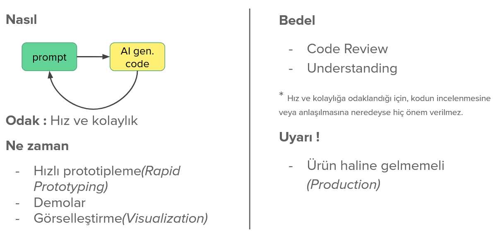
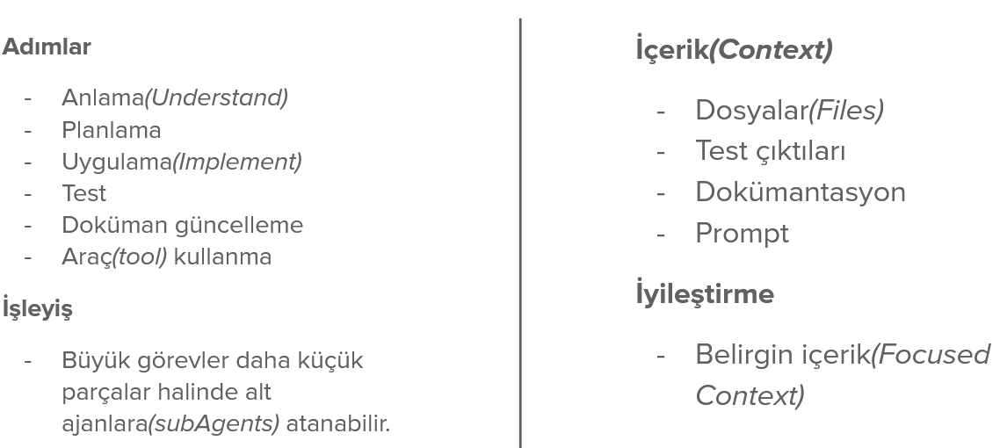
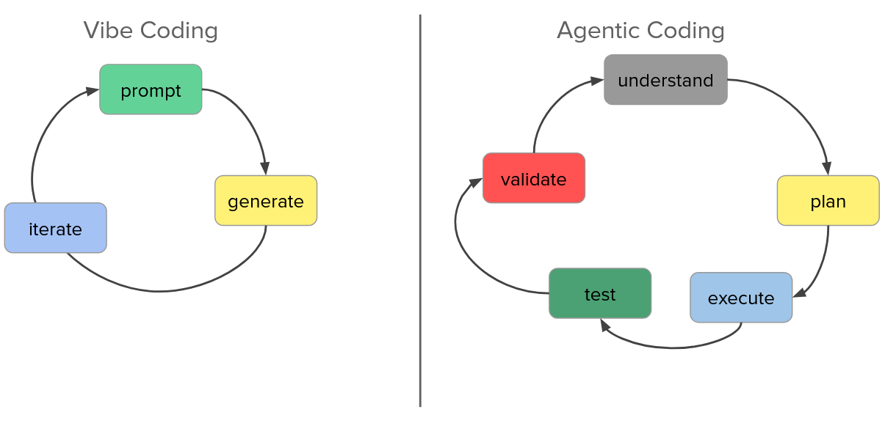
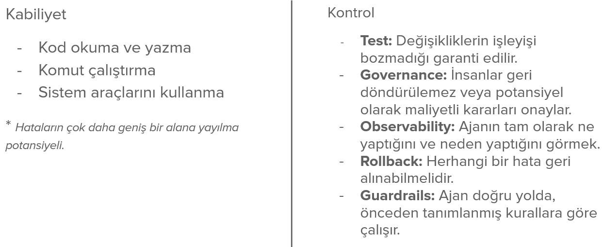
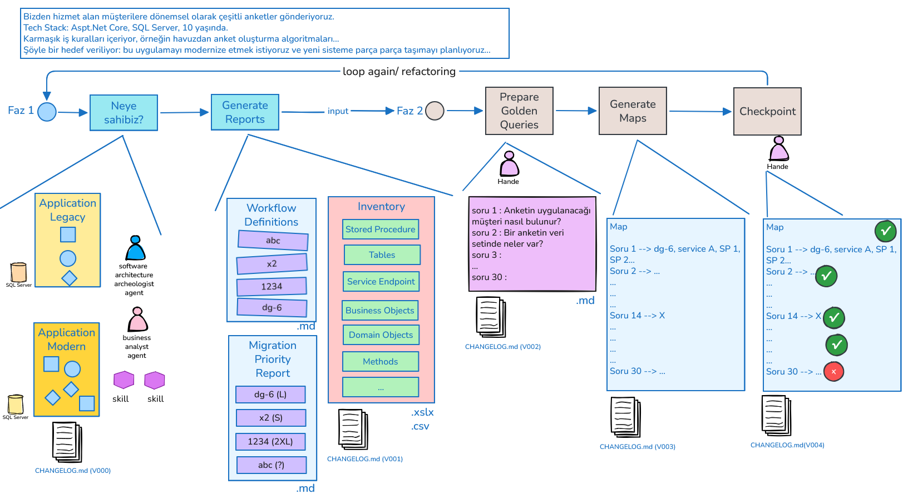

# Bölüm 15: Vibe Coding ve Agentic Coding: Ne Zaman Hangisi?

<!-- nav:top:start -->
[← Bölüm 14](chapter-14.md#top) · [İçindekiler](README.md#top) · [Bölüm 16 →](chapter-16.md#top)
<!-- nav:top:end -->

Yapay zekanın yazılım geliştirme süreçlerine dahil olmasıyla birlikte geliştiricilerin verimliliği ciddi oranda arttı. Ancak bu hız artışı; kod kalitesi, güvenlik ve geliştiricilerin kendi teknik becerilerini kaybetme endişesi gibi yeni tartışmaları da beraberinde getirdi. Andrej Karpathy'nin 2025 başlarında literatüre kazandırdığı **Vibe Coding** kavramı, kodlama bilmeyenlerin bile hızla uygulama geliştirebileceği fikrini popülerleştirdi. Ancak unutmamalıyız ki her yazılım geliştirme süreci aynı değildir. Yapay zeka destekli doğru geliştirme pratiğini seçebilmek için **Vibe Coding** ve **Agentic Coding** yaklaşımlarını, iş akışlarını ve güvenlik dinamiklerini net bir şekilde anlamamız gerekir.

Önceki bölümlerde RAG, MCP, custom agent ve skill gibi araçları tek tek ele aldık. Bu bölümde bir adım geri çekilip şu soruya odaklanacağız: Bu araçları hangi yaklaşımla ve hangi disiplinle kullanıyoruz?

## Vibe Coding: Hız ve Keşif Odaklı Geliştirme

Vibe Coding, yazılımın temel olarak gündelik dilde yazılan prompt'lar ve yapay zeka tarafından üretilen kod üzerinden şekillendirildiği bir döngüyü tarifler. Bu yaklaşımda asıl odak noktası **hız ve kolaylıktır**. Geliştirici ne istediğini tarif eder, yapay zeka bir taslak üretir ve istenen sonuca ulaşılana kadar bu döngü tekrarlanır.

- **Ne Zaman Kullanılmalı?** Hızlı prototipleme *(rapid prototyping)*, deneysel hafta sonu projeleri, fikirlerin görselleştirilmesi *(visualization)* ve hızlı demolar hazırlamak için idealdir. Kodlama geçmişi olmayan birisi birkaç saat içerisinde çalışan bir prototip ortaya çıkarabilir. [Bölüm 01](chapter-01.md#top)'deki CV'yi HTML sayfasına dönüştürdüğümüz ilk uygulama bu yaklaşıma iyi bir örnektir.
- **Gizli Bedel *(Trade-off)*:** Hız ön planda olduğu için üretilen kodun incelenmesine *(code review)* veya mimarisinin anlaşılmasına neredeyse hiç vakit ayrılmaz. Yapay zeka, istenen çıktıyı vermekte çok başarılı olsa da kıdemli bir geliştiricinin sahip olduğu insan düzeyindeki ayırt etme yeteneğine *(human discernment)* sahip değildir.
- **Kritik Uyarı:** Bu yöntemle üretilen kodlarda tekrar eden fonksiyonlar, karmaşık dosya yapıları ve basit hatalar için dolambaçlı çözümler sıkça görülür. Yani [Bölüm 05](chapter-05.md#top)'te ele aldığımız teknik borç hızla birikir. Bu nedenle Vibe Coding çıktıları doğrudan **canlı ortama *(production)* alınmamalıdır.**

## Agentic Coding: Yapay Zeka ile Mühendislik Ortaklığı

Agentic Coding, yapay zekanın yalnızca kod üreten bir araç olmaktan çıkarak geliştiriciyle birlikte çalışan bir mühendise dönüştüğü yaklaşımı tarifler. Kodlama ajanları mevcut kod tabanını anlayabilir, değişiklikleri planlayabilir, tasarım desenleri uygulayabilir, test koşabilir, dokümantasyon güncelleyebilir ve harici geliştirme araçlarıyla etkileşime girebilir.

- **İşleyiş ve Alt Ajanlar *(Sub-Agents)*:** Büyük ve karmaşık görevler tek bir modele yüklenmek yerine daha küçük parçalara bölünerek özelleşmiş alt ajanlara devredilir. Örneğin sadece testleri çalıştıran bir sub-agent'ın **GitHub** erişimi kısıtlanarak hem görev odağı hem de yetki sınırları korunur. Bu tür ajanların nasıl tanımlandığını [Bölüm 14](chapter-14.md#top)'te frontmatter içindeki `tools` alanı üzerinden incelemiştik.
- **Odaklanmış Bağlam *(Focused Context)*:** Büyük dil modelleri *(Large Language Models - LLM)* çalışma anında kendilerine sunulan bağlama *(dosyalar, test çıktıları, dokümantasyon, prompt)* göre karar verir. Ancak modellerin dikkat kapasitesi sınırlıdır *(Bknz: [Bölüm 09](chapter-09.md#top) - Bağlam Yönetimi)*. Gereğinden fazla ve dağınık bilgi verilmesi modelin önemli noktaları kaçırmasına sebep olabilir. Alt ajanların kod tabanının belirli bir bölümünü araştırıp ana ajana özet sunması, ana ajanın planlama ve orkestrasyona odaklanmasını sağlar.

## İş Akışlarının Karşılaştırılması

İki yaklaşım arasındaki temel fark, geliştiricinin sürece dahil olduğu zihinsel efor ve kontrol noktalarında gizlidir.

| **Özellik / Aşama** | **Vibe Coding** | **Agentic Coding** |
| :--- | :--- | :--- |
| **Temel Döngü** | Prompt -> Üret *(Generate)* -> Yinele *(Iterate)* | Anla -> Planla -> Uygula -> Test Et -> Doğrula |
| **İnsan Katılımı** | Minimum düzeydedir. Kodun içeriğine bakılmadan çıktıya odaklanılır. | Yüksek düzeydedir. Özellikle **Anlama** ve **Doğrulama** adımlarında insan devrededir. |
| **Bağlam *(Context)* Yönetimi** | Genellikle anlık prompt'lar ile sınırlıdır. | Dosyalar, test sonuçları ve dokümantasyonla beslenen odaklanmış bağlam kullanılır. |
| **Hedef Çıktı** | Çalışan taslak veya görsel prototip. | Sürdürülebilir, test edilmiş ve üretime hazır yazılım. |

> Agentic Coding'deki *Anla -> Planla -> Uygula -> Test Et -> Doğrula* akışını otomatik olarak tekrar eden ve ölçülebilir bir hedefe bağlayan sisteme bir sonraki bölümde **Döngü Mühendisliği *(Loop Engineering)*** adıyla değineceğiz.

## Agentic Coding ve Güvenlik

Ajanların kod okuma/yazma, terminal komutları çalıştırma ve sistem araçlarını kullanma yetenekleri arttıkça, olası bir hatanın etki alanı da aynı oranda genişler. Bu nedenle ajan özerkliği arttığında aşağıdaki temel kontrol mekanizmaları zorunlu hale gelir.

| **Mekanizma** | **Ne Sağlar?** | **Derste Nerede?** |
| --- | --- | --- |
| **Test *(Testing)*** | Yapılan değişikliklerin mevcut sistem işleyişini bozmadığının otomatik testlerle garanti altına alınması. | [Bölüm 06](chapter-06.md#top) |
| **Yönetişim *(Governance)*** | Geri döndürülemez veya yüksek maliyetli kararların *(örneğin canlı veritabanı değişiklikleri)* mutlaka insan onayından geçmesi. | [Bölüm 16](chapter-16.md#top) - Hook ile kalite kapısı |
| **Gözlemlenebilirlik *(Observability)*** | Ajanın tam olarak hangi adımları attığının ve bu kararları neden aldığının şeffaf bir şekilde izlenebilmesi. | [Bölüm 04](chapter-04.md#top), [Bölüm 17](chapter-17.md#top) |
| **Geri Alma *(Rollback)*** | Ajanın yaptığı herhangi bir hatanın sistemi kesintiye uğratmadan hızla geri alınabilmesi. | Versiyon kontrolü, küçük ve sık commit'ler |
| **Korkuluklar *(Guardrails)*** | Ajanın önceden tanımlanmış kurallar ve yetki sınırları dışına çıkmadan çalışmasının sağlanması. | [Bölüm 14](chapter-14.md#top), [Bölüm 19](chapter-19.md#top) |

## Hangi Yaklaşımı Seçmeliyiz?

"Hangisi daha iyi?" sorusu yerine **"Elimdeki görev ne kadar bağlam, planlama, doğrulama ve özerklik gerektiriyor?"** sorusunu sormak daha doğrudur.

- **Vibe Coding'i tercih edelim:** Hızlı hata düzeltmeleri *(quick fix)*, yeni bir arayüz tasarımı denemesi, değişken isimlerini yenileme, metot parametrelerini struct'a çevirme gibi küçük refactoring işlemleri veya tek kullanımlık prototipler oluşturma aşamalarında.
- **Agentic Coding'i tercih edelim:** Yeni özellikleri canlı ortama *(production)* alırken, veritabanı veya ödeme sistemleri gibi kritik altyapılara dokunurken ve kapsamlı kod iyileştirmeleri *(large-scale refactoring)* yaparken.

> Dönem projelerinde de [Ders Rehberi](course-guide.md)'nde belirtildiği gibi Vibe Coding pratiklerinden ziyade Agentic Engineering yaklaşımını benimsememiz beklenir. Prototipi hızla çıkarmak için Vibe Coding'den yararlanabiliriz ancak teslim edilen kodun her satırını açıklayabilmemiz gerekir.

### Bu bölümden çıkarılması gereken dersler

- Vibe Coding ve Agentic Coding birbirinin rakibi değil, farklı risk seviyelerine uygun iki araçtır. Seçimi görevin riski belirler.
- Vibe Coding çıktısı bir **taslaktır**. Canlı ortama gitmeden önce inceleme, test ve yeniden yapılandırmadan geçmelidir.
- Agentic Coding'de insan süreçten çıkmaz, rolü değişir. Kod yazan kişi olmaktan çok bağlamı hazırlayan, planı onaylayan ve sonucu doğrulayan kişi oluruz.
- Ajanın özerkliği arttıkça test, yönetişim, gözlemlenebilirlik, geri alma ve korkuluk mekanizmaları opsiyonel olmaktan çıkar.
- Yapay zeka araçlarını kullanmaktan çekinmek yerine görevin riskine uygun yaklaşımı seçmek ve **üretilen kodu açıklayabilen kişi olmaya devam etmek**, modern yazılım geliştirmenin anahtarıdır.

Kaynak: IBM Technology, *Vibe Coding vs Agentic Coding: Which Should You Use?*, Grace Ableidinger, 2026

## Örnek Senaryo 1 (Agentic Coding)

<!-- nav:bottom:start -->
---

| ← Önceki Bölüm | İçindekiler | Sonraki Bölüm → |
| :--- | :---: | ---: |
| [Bölüm 14: Custom Agent, Skill ve Plugin Yapıları ile Çalışmak](chapter-14.md#top) | [İçindekiler](README.md#top) | [Bölüm 16: Döngü Mühendisliği (Loop Engineering)](chapter-16.md#top) |
<!-- nav:bottom:end -->
