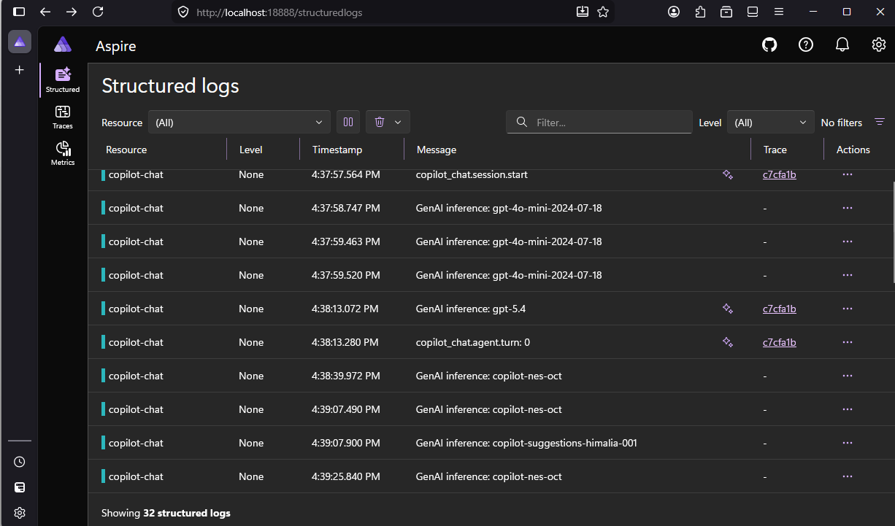
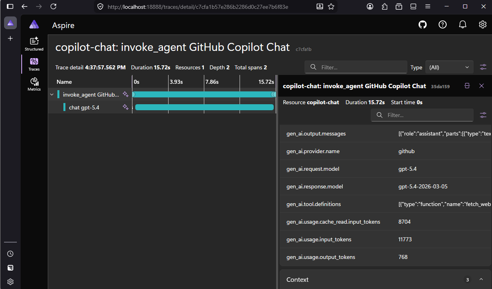
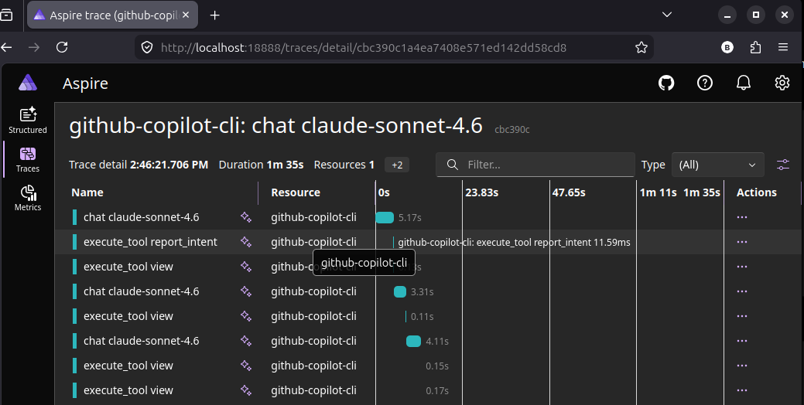
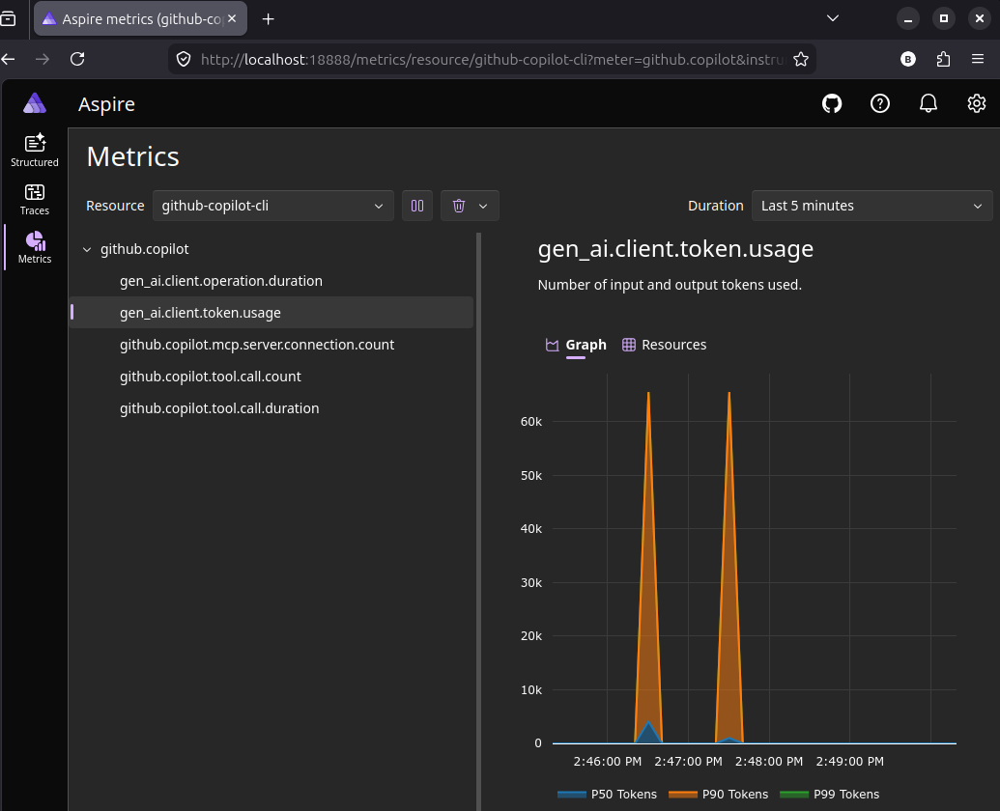

<a id="top"></a>

# Bölüm 16: Token Kullanımlarını Open Telemetry ve Aspire Dashboard ile İzlemek

<!-- nav:top:start -->
[← Bölüm 15](chapter-15.md#top) · [İçindekiler](README.md#top) · [Bölüm 17 →](chapter-17.md#top)
<!-- nav:top:end -->

Yapay zeka araçlarının token maliyetleri, kullanım bedelleri ve lisanslamalar zamanla değişiyor. Bu nedenle yapay zeka destekli uygulamalar geliştirirken, bu araçların kullanımını ve maliyetlerini izlemek önemlidir. **Open Telemetry** gibi açık kaynaklı gözlemleme araçları, uygulamanızın yapay zeka araçlarına yaptığı çağrıları, kullanılan token miktarını ve diğer ilgili metrikleri takip etmek için kullanılabilir. **Aspire Dashboard** gibi özel panolar ise bu verileri görselleştirerek, hangi araçların ne kadar kullanıldığını, hangi işlemlerin daha fazla token tükettiğini ve genel maliyet trendlerini anlamanıza yardımcı olabilir. Örneğin **Visual Studio Code** arabiriminde çalışırken, **Context Window** daki kullanımları **Open Telemetry** araclığı ile **Microsoft Aspire Dashboard**' a gönderip takip edebiliriz.

## Setup (Visual Studio Code)

Öncelikle Aspire Dashboard' u ayağa kaldıralım. Local ortamda çalışırken bu amaçla **docker container** kullanabiliriz. **docker-compose.yml** dosyasına aşağıdaki servisi eklemek yeterli.

```yaml
aspire-dashboard:
    image: mcr.microsoft.com/dotnet/aspire-dashboard:latest
    container_name: ai-aspire-dashboard
    restart: always
    ports:
      - "18888:18888" # Dashboard UI Portu
      - "4317:18889"  # OTLP gRPC Portu (VS Code Copilot'un veri göndereceği port)
      - "4318:18890"  # OTLP HTTP Portu
    environment:
      ASPIRE_DASHBOARD_UNSECURED_ALLOW_ANONYMOUS: "true"
```

Eğer Aspire Dashboard'unu doğrudan docker ile başlatmak istersek aşağıdaki komutla da hareket edebiliriz.

```bash
docker run -d --name aspire-dashboard --restart unless-stopped -p 18888:18888 -p 4317:18889 -p 4318:18890 -e ASPIRE_DASHBOARD_UNSECURED_ALLOW_ANONYMOUS=true mcr.microsoft.com/dotnet/aspire-dashboard:latest
```

Servisi başlattıktan sonra `http://localhost:18888` adresinden Aspire Dashboard' a erişebiliriz. Dashboard üzerinde yapay zeka araçlarının kullanımını izlemek için **Open Telemetry**'nin OTLP protokolü üzerinden veri göndermesi gerekir. **Visual Studio Code** üzerinde çalışırken, **VS Code Copilot** gibi yapay zeka araçlarının kullanımını izlemek için **Open Telemetry**'nin OTLP gRPC portuna veri göndermesi sağlanabilir. Bunun için **VS Code**'un `settings.json` dosyasına aşağıdaki konfigürasyonu ekleyebiliriz.

```json
"github.copilot.chat.otel.enabled": true,
"github.copilot.chat.otel.exporterType": "otlp-grpc",
"github.copilot.chat.otel.otlpEndpoint": "http://localhost:4317",
"github.copilot.chat.otel.captureContent": true
```

Öncelikle otel.enabled ile Telemetry log aktarım özelliğini etkinleştiriyoruz. Verinin **gRPC** protokolü üzerinden gönderilmesi için exporterType'ı `otlp-grpc` olarak belirtiyoruz. Local ortamda logların akacağı endpoint'i ise `http://localhost:4317` olarak tanımlıyoruz. Son olarak **captureContent** özelliği ile logların içeriğinin de gönderilmesini sağlıyoruz.

## Deneme

Örnek bir senaryo ile logları inceleyelim. Context Window pencersinde, **ask** modunda, herhangi bir dil modeline aşağıdaki soruyu sorduğumuzu düşünelim. *(docker-compose.yml dosyası açıkken)*

```text
Bu docker dosyasındaki servislerin hangi amaçla kullanıldığını söyler misin?
```

İşlemler devam ederken ve tamamlandığında **Aspire Dashboard**'un logları yakaladığını görürüz.



Özellikle dikkat etmemiz gereken noktalardan birisi söz konusu işlemler için harcanan token miktarlarıdır. Örneğin bu soru için içeriğin hazırlandığı **Mayıs 2026** tarihi itibariyle **gpt 5.4** modeli için harcanan token değerleri aşağıdaki gibidir.

- Cache Üzerinden Okunan Token Sayısı: 8704
- Girdi Token Sayısı: 11773
- Çıktı Token Sayısı: 768



## Setup (Copilot CLI)

Vekil yapay zeka ajanları farklı araçlarla kullanılabilir. Visual Studio Code, Visual Studio gibi kod geliştirme araçlarının chat pencereleri, Claude CLI gibi terminal arabirimleri vs Aradaki iletişimi dinleyerek giden gelen token değerlerini, sistem promptlarını, süre bazlı ölçümlemeleri görmek mümkündür. Tüm bunlar ilgili arabirimlerin **Open Telemetry** gibi standartlarda bilgi vermesi üzerine kuruludur. Ölçümlerde bir dashboard kullanarak monitoring kolaylaştırılır. Copilot CLI tarafından çıkan metriklerin izlenmesi için de bazı ortam parametrelerinin sisteme eklenmesi gerekir. **Windows** ortamında aşağıdaki **powershell** komutları ile ilerlenebilir. Burada kullanıcı bazından bir ortam ayarı yapılmaktadır.

```bash
Environment]::SetEnvironmentVariable(
    "COPILOT_OTEL_ENABLED",
    "true",
    "User"
)

[Environment]::SetEnvironmentVariable(
    "OTEL_EXPORTER_OTLP_ENDPOINT",
    "http://localhost:4318",
    "User"
) 

[Environment]::SetEnvironmentVariable(
    "COPILOT_OTEL_EXPORTER_TYPE",
    "otlp-http",
    "User"
) 

[Environment]::SetEnvironmentVariable(
    "OTEL_SERVICE_NAME",
    "github-copilot-cli",
    "User"
)
```

Ubuntu tarafında kalıcı olarak ilgili ayarları oluşturmak için ilgili değişkenler doğrudan `~/.bashrc` dosyasına eklenebilir.

```bash
cat >> ~/.bashrc <<'EOF'

# GitHub Copilot CLI - OpenTelemetry
export COPILOT_OTEL_ENABLED=true
export OTEL_EXPORTER_OTLP_ENDPOINT=http://localhost:4318
export COPILOT_OTEL_EXPORTER_TYPE=otlp-http
export OTEL_SERVICE_NAME=github-copilot-cli
EOF
```

> Sistemde birden fazla open telemetry değişkeni kullanılacaksa ayrı konfigurasyon dosyaları hazırlayıp `bashrc` dosyasından referans vermek daha mantıklı olur.

Copilot CLI kullanımı sırasında Aspire Dashboard ile izlenebilecek örnek sayfalar aşağıdaki gibidir.



Örnek bir istek sonrası oluşan token kullanımlarına ait grafiksel özet.



<!-- nav:bottom:start -->
---

| ← Önceki Bölüm | İçindekiler | Sonraki Bölüm → |
| :--- | :---: | ---: |
| [Bölüm 15: Döngü Mühendisliği (Loop Engineering)](chapter-15.md#top) | [İçindekiler](README.md#top) | [Bölüm 17: LoRA *(Low-Rank Adaptation)* ile Model Özelleştirme](chapter-17.md#top) |
<!-- nav:bottom:end -->
