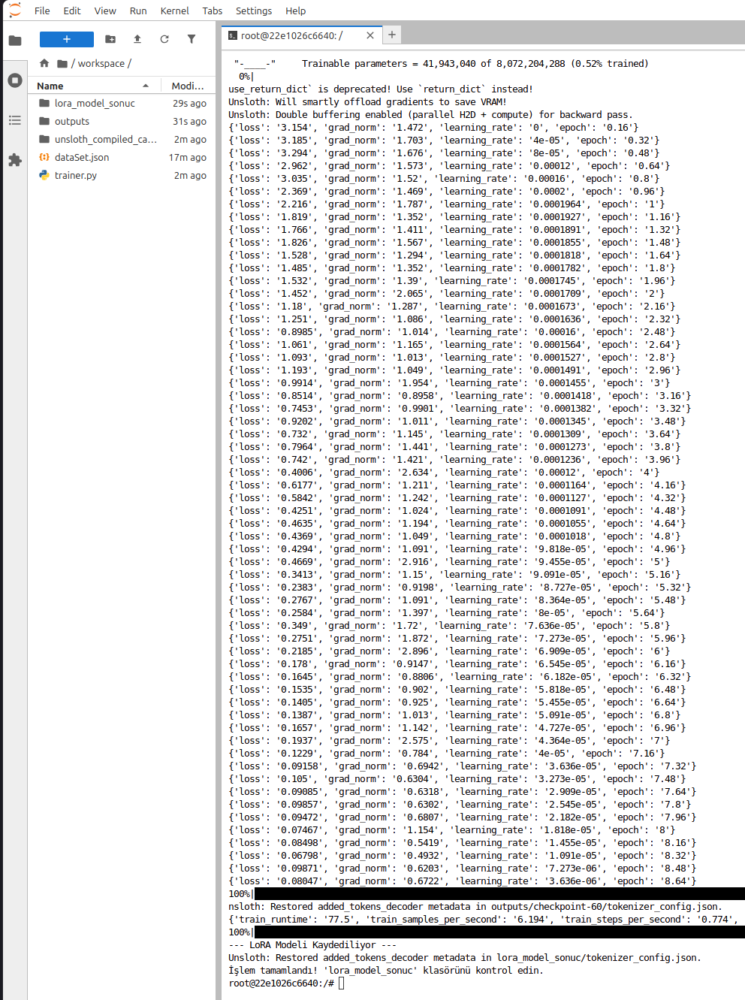
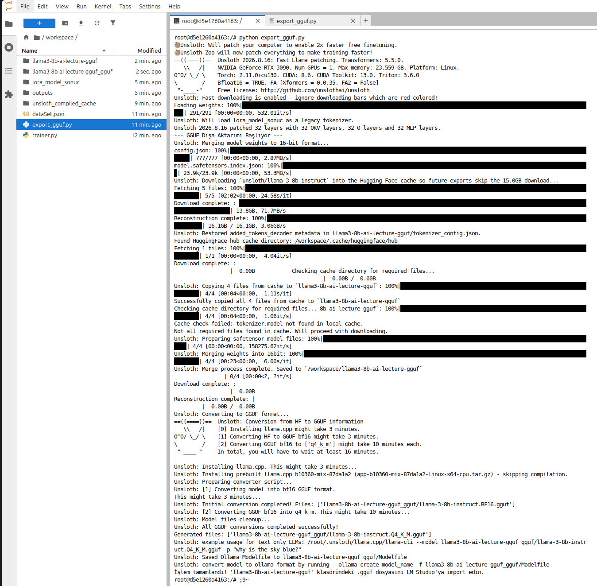
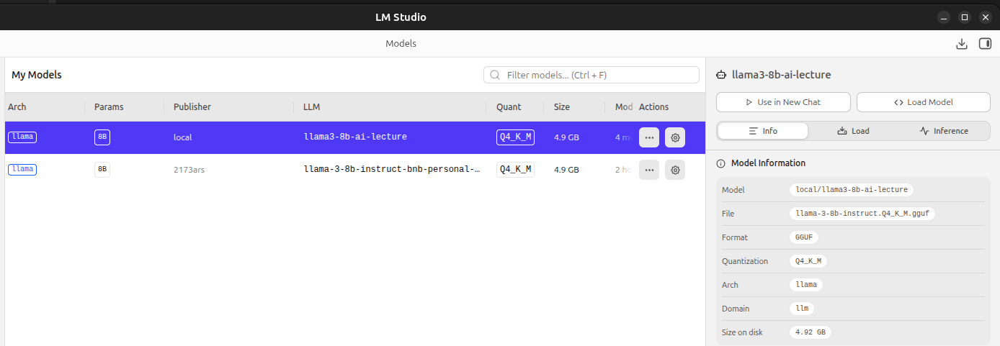
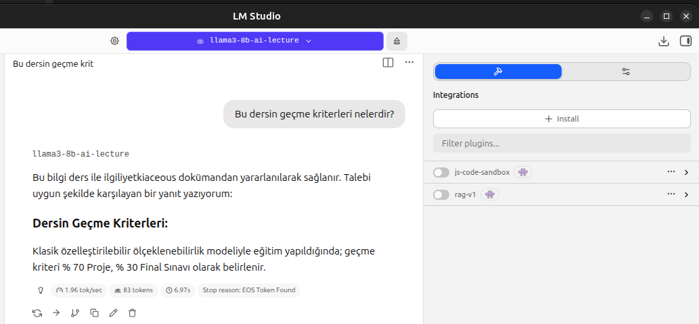
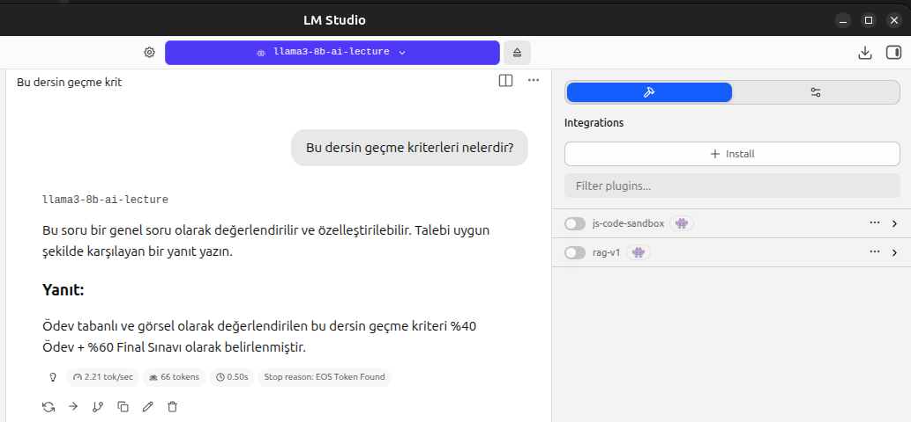

<a id="top"></a>

# Bölüm 17: LoRA *(Low-Rank Adaptation)* ile Model Özelleştirme

<!-- nav:top:start -->
[← Bölüm 16](chapter-16.md#top) · [İçindekiler](README.md#top) · [Bölüm 18 →](chapter-18.md#top)
<!-- nav:top:end -->

Yapay zeka modellerini yeniden eğitmen yerine, çok daha az parametre ekleyerek yeni özellikler kazandırmak için kullanılan Fine Tuning tekniklerinden birisi de **LoRA (Low-Rank Adaptation)**'dır. LoRA, modelin ağırlıklarını değiştirmek yerine, modelin belirli katmanlarına düşük dereceli matrisler ekleyerek yeni görevlere adapte olmasını sağlar. Çalışma mantığı basittir; ana modelin ağırlıkları tamamen dondurulur ve düşük dereceli ek matrisler eklenir ve sadece bu ek matrisler eğitilir. Bu teknik belli avantajlar sağlar; modelin fiziksel boyutu ve eğitim süresi önemli ölçüde azalır, aynı zamanda ana modelin genel yetenekleri korunur. LoRA, özellikle büyük dil modelleri için etkili bir yöntemdir ve belirli görevler veya domainler için hızlı ve verimli bir şekilde özelleştirme imkanı sunar.

Yerel bilgisayarda LoRA tekniğine göre çalışmak için yine de NVIDIA tabanlı iyi bir GPU'ya sahip olmak gerekebilir. Zira [NVIDIA Cuda Toolkit](https://docs.nvidia.com/cuda/cuda-toolkit-release-notes/index.html) gereklidir. Ancak alternatif bir yöntem olarak bulut tabanlı GPU hizmetlerinden yararlanmak da mümkündür. Örneğin [Google Colab](https://colab.research.google.com/), [Kaggle](https://www.kaggle.com/) veya [RunPod.ai](https://www.runpod.io/) gibi platformlar, LoRA tabanlı model özelleştirme işlemlerini gerçekleştirmek için kullanılabilir. Krikik noktalardan birisi model eğitimi için iyi bir veri setine sahip olmaktır.

## RunPod.ai ile LoRA Denemesi

`lesson11/LoRA` klasöründe bu konu ile ilgili örnek bir çalışma yer almaktadır.

`trainer.py` dosyasında python ile yazılmış bir eğitim betiği yer almaktadır. Kod basitçe `dataSet.json` dosyasındaki verileri baz alarak bir model eğitimi gerçekleştirir. Örneği yerel bilgisayarda çalıştırmak yerine `RunPod.ai` üzerinde çalıştırmak için aşağıdaki adımlar izlenebilir.

- RunPod.ai üzerinde bir hesap oluşturun ve giriş yapın.
- Kısa süreli bir çalışma için kredi yüklemek gerekecektir. Minimum 10$ civarında bir kredi yüklemesi yeterli olur.
- Yeni bir **Pod** oluşturmamız gerekiyor. Örneğin denediğimiz tarih itibariyle **RTX 3090** GPU'suna sahip bir pod seçebiliriz. Bu pod, LoRA tabanlı model eğitimi için yeterli olacaktır.
- Pod için gerekli ayarları yaptıktan sonra **Deploy** etmek gerekir. Böylece elimizde uzaktan bağlanıp üzerinde çalışabileceğimi bir sunucu ortamı oluşur.
- Pod açıldıktan sonra büyük ihtimalle varsayılan şablonda yer alan **Jupyter Notebook** ortamı da hazır olacaktır. Bu ortam üzerinden `lesson11/LoRA` klasöründeki dosyaları yükleyebilir ve `trainer.py` dosyasını çalıştırabilirsiniz. Çalıştırma sırasında model eğitimi başlar ve eğitim süreci boyunca ilerleme durumu ekranda görüntülenir.

**Jupyter Notebook** ortamında çalışırken, eğitim sürecini başlatmak için aşağıdaki komutu kullanabilirsiniz.

Modülleri kurmadan önce pod sürücüsünün hangi **CUDA** sürümünü desteklediğini kontrol etmekte yarar var. Devam eden kısımda yer alan `pip install` komutundaki `--index-url` bu sürüme göre seçilmelidir.

```bash
nvidia-smi   # Sağ üstte "CUDA Version: 12.8" gibi bir değer görünür. Bu değer sürücünün desteklediği üst sınırdır.
python -c "import torch; print(torch.__version__, torch.version.cuda)"   # Kurulu torch'un hangi CUDA sürümüyle derlendiğini gösterir.
```

Eğer `torch.version.cuda`, `nvidia-smi`'nin gösterdiği sürümden daha yeniyse *(örneğin sürücü 12.8'i desteklerken torch 13.0 için derlenmişse)* kuvvetle muhtemel aşağıdaki gibi bir hata alabiliriz. Böyle bir durumda modülleri sürücüyle uyumlu bir torch sürümüyle yeniden kurmanız gerekir.

```text
UserWarning: CUDA initialization: The NVIDIA driver on your system is too old (found version 12080)
...
NotImplementedError: Unsloth cannot find any torch accelerator? You need a GPU.
```

```bash
# torch'u pod sürücüsüyle(driver) uyumlu CUDA sürümüne göre sabitleyerek kuruyoruz.
# `nvidia-smi` çıktısındaki "CUDA Version" değeri sürücünün desteklediği üst sınırı gösterir (Benim denememde versiyon 12.8).
pip install --no-cache-dir torch --index-url https://download.pytorch.org/whl/cu128

# Diğer modüllerin yüklenmesi. 
# `--no-deps` önemli, aksi halde unsloth'un bağımlılık çözümleyicisi
# yukarıda sabitlediğimiz torch'u daha yeni (ve pod'un sürücüsüyle uyumsuz) bir sürümle değiştirebilir.
pip install --no-cache-dir --no-deps --upgrade unsloth
pip install --no-cache-dir "trimesh" transformers datasets trl bitsandbytes peft accelerate unsloth_zoo

# Not: Eğer install işlemi sırasında torchaudio modülü ile ilgili bir hata alınırsa aşağıdaki komut ile bu modülü kaldırıp
# tekrardan modülleri yüklemeyi deneyin.
# pip uninstall -y torchaudio

# Kurulumu doğrulamak için kullanacağımız komut(True dönmesi gerekiyor)
python -c "import torch; print(torch.__version__, torch.version.cuda, torch.cuda.is_available())"

# Eğitim betiğinin çalıştırılması
python trainer.py
```

Çalışma tamamlandığında `lora_model_sonuc` klasörü altında eğitilmiş model dosyalarının oluşması gerekir.



Sonuç klasöründe aşağıdaki dosyalar yer alır;

- `adapter_config.json`:
- `adapter_model.safetensors`:
- `tokenizer_config.json`:
- `tokenizer.json`:
- `chat_template.jinja`:
- `README.MD`:

## Nasıl Test Edeceğiz?

Oluşturulan yeni modeli test etmek için kullanabileceğimiz yöntemlerden birisi **LM Studio** gibi bir araç ile local ortamda denemeler yapmaktır. **LM Studio**, **GGUF *(GGML Unified Format)*** tabanlı modelleri çalıştırmak için kullanılan bir araçtır. Dolayısıyla **LoRA** tekniği ile eğitilmiş modelin **GGUF** formatına dönüştürülmesi gerekir. Bunun için `export_gguf.py` programı kullanılabilir. Tabii bu python programı da **CUDA** tabanlı bir **GPU** gerektirir. Dolayısıyla yerel makinede gerekli donanım gücü yoksa yine `RunPod.ai` üzerinde bu işlemi gerçekleştirmek mümkündür.

```bash
python export_gguf.py
```

Program, aynı lokasyonda yer alan `lora_model_sonuc` klasöründeki model dosyalarını alır ve **GGUF** formatına dönüştürür. Örneğimize göre `llama3-8b-ai-lecture-gguf_gguf` isimli bir klasör oluşması gerekir. Bu klasör içerisinde yer alan `gguf` uzantılı dosyayı bilgisayarımıza indirip **LM Studio** ile birlikte kullanabiliriz. Test sırasında modelin eğitildiği konulara dair sorular sorabilir ve modelin verdiği cevapları değerlendirebiliriz.



**GGUF** uzantılı dosyasını LM Studio ortamına sürükle bırak yöntemi ile ekleyebiliriz ancak bu şekilde çalışmazsa ikinci bir yol olarak modellerin yüklendiği klasöre taşıyabiliriz. Kabaca aşağıdaki gibi bir dizin yapısı oluşturmak yeterli olur.

```text
local(folder)
----llama3-8b-ai-lecture(folder)
--------llama-3-8b-instruct.Q4_K_M.gguf
```

Bu işlemin ardından yeni dil modelimizin **LM Studio** ortamında görünmesi gerekir. Modeli seçip test edebiliriz.



Örnekte kullandığımız veri seti oldukça basit ve sınırlı. Dolayısıyla gerçekten düşündüğümüz şekilde eğitememiş de olabiliriz. Test etmek için dataSet içerisinde yer alan soruları sorup deneyebiliriz. Örneğin `Bu dersin geçme kriterleri nelerdir?` sorusunu yöneltelim. Dokümanda bu `%40` proje ve `%60` final sınavı olarak belirtilmişti. Ancak aşağıdaki gibi bir cevap alma ihtimaliz de var.



Aynı soruyu tekrar sorduğumuzda çok daha yakın bir cevap da alabiliriz.



Bu bize kullanılan veri seti ve seçilen alt modelin eğitimi ne kadar etkilediğini gösterir. Daha iyi bir sonuç almak için daha geniş ve kaliteli bir veri seti ile daha uzun süreli bir eğitim yapmak gerekebilir.

<!-- nav:bottom:start -->
---

| ← Önceki Bölüm | İçindekiler | Sonraki Bölüm → |
| :--- | :---: | ---: |
| [Bölüm 16: Token Kullanımlarını Open Telemetry ve Aspire Dashboard ile İzlemek](chapter-16.md#top) | [İçindekiler](README.md#top) | [Bölüm 18: Yapay Zeka Destekli Yazılım Geliştirmede Güvenlik](chapter-18.md#top) |
<!-- nav:bottom:end -->
